# Customizer

[WordPress Version 3.4](https://wordpress.org/documentation/wordpress-version/version-3-4/) introduced Theme Customizer, which allows you to play around with various looks and settings for your current theme or one you’re thinking about switching to without publishing those changes to the whole world. For themes that support it, you can change colors, backgrounds, custom image headers, and so on.

If you select Appearance -> Customize menu from the [Administration Screens](../README.md), Theme Customizer is launched. The Customizer allows you to preview changes to your site before publishing them. If you directly modify theme files and they are updated, then your modifications may be lost. By using Customizer you will ensure that your modifications are preserved.

**Important Note**:

The Customizer is only available if the active theme supports a Customize ability. For [Block themes](../../../editing-and-design/themes/block-themes.md) that support building your site with blocks, this means you will not need to use the Customizer causing it to be hidden except if you are using a plugin that requires it. In addition, this screen will likely be different for each Theme that enables and builds it. The Customizer for [WordPress Twenty Twenty-One theme](../../../editing-and-design/themes/default-themes/twenty-twenty-one/README.md), for example, provides options to change the background colors, select a background image and turn on the Dark Mode.

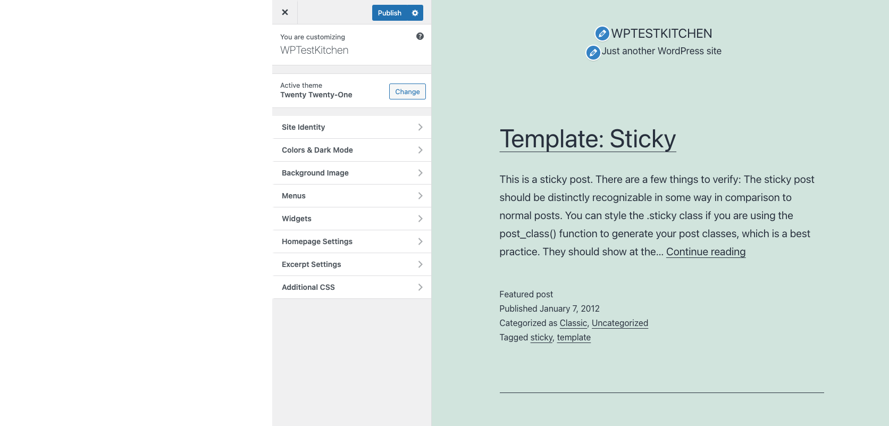

*Customizer of Twenty Twenty-One Theme*

## Basic Usage

### How to start the Customizer

To start the Customizer, follow one of these steps:

-   From Administration Screens, Select Appearance -> Customize
-   From Toolbar, Select Customize

### How to use it

From left side menu, open the option category and specify the option value. Notice that during your changes, the preview screen is also changed. After you finished the customization, click the Publish button to enhance the changes to your site.

There are some tips:

-   You can click the internal links in the preview screen. Customizer will navigate to the clicked page and display it with current customizing option value.

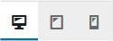

*Device Preview Button*

-   Device Preview Buttons at the bottom of the Customizer pane shows how your site looks in mobile, tablet, and desktop contexts before making changes to its appearance.

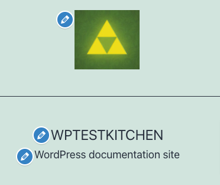

*Blue pencil icon in Preview pane*

-   Clicking blue pencil icon in Preview screen will open corresponding control menu in the left side pane.

## Menu Options

### Site Identity

This menu allows you to specify basic site information.

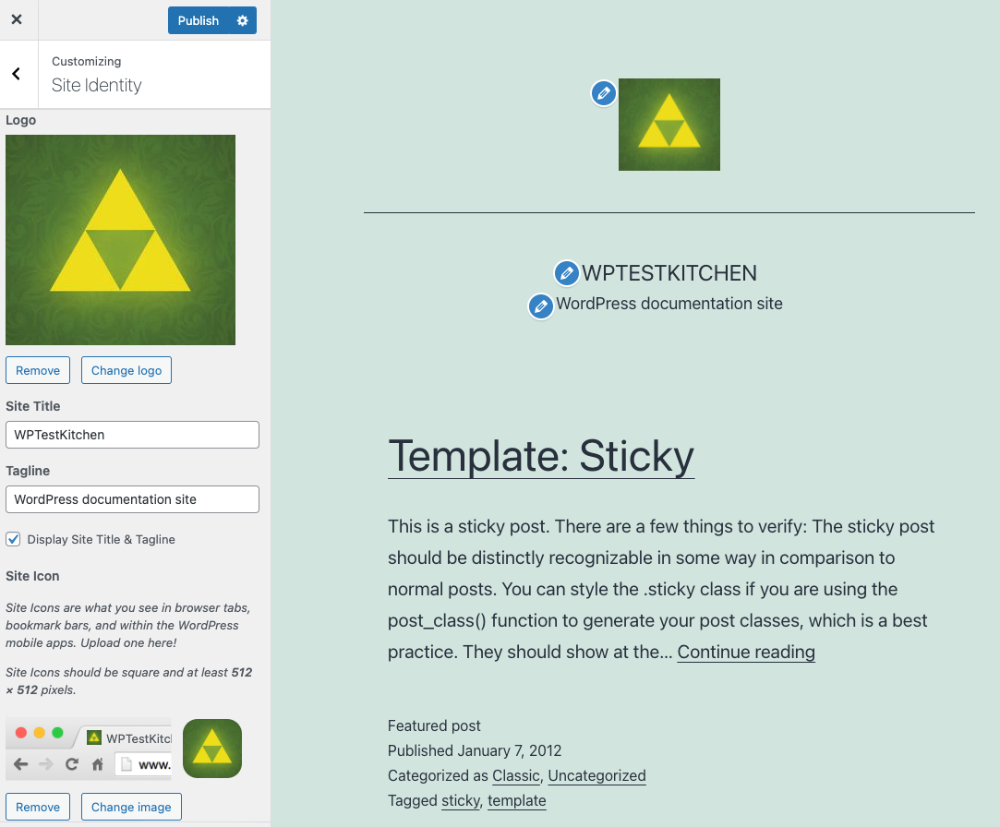

*Customizer Site Identity screen*

-   **Logo** – Site logo image such as corporate symbol 
    Click Select Logo to open the Media Library. Select an image from it or upload the new image from Upload Files Tab screen and click Choose logo button at the bottom right. 
    Click Remove or Change logo to remove or change site logo image.
-   **Site Title** – Text box for site title
-   **Tagline** – Text box for tag line
-   **Display Site title and tagline** – Checkbox to enable or hide the display of title and tag line
-   **Site Icon** – The Site Icon is used as a browser and app icon for your site. Icons must be square, and at least 512 pixels wide and tall. 
    Click Select Image to open the Media Library. Select an image from it or upload the new image from Upload Files Tab screen and click Select button at the bottom right.

### Colors & Dark Mode

Colors & Dark Mode menu allows the customization of the background color as displayed by the theme. It also helps to activate the Dark Mode support for the theme.

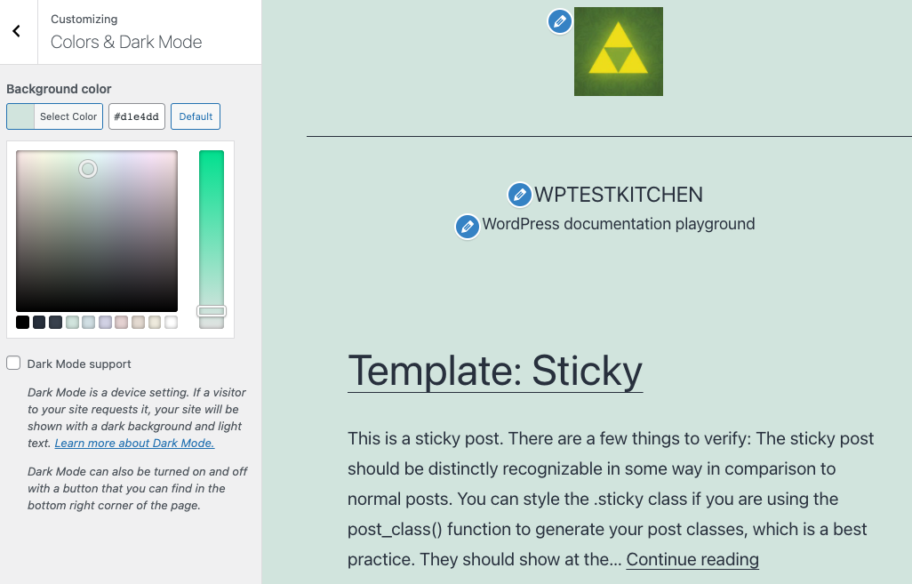

*Colors & Dark Mode*

-   **Background Color** – Click the Select color button. You can either enter a [hexadecimal number](https://en.wikipedia.org/wiki/Web_colors) (e.g. d33131) representing the color to be displayed as the background of your theme, or from the color picker, click the desired color and the hexadecimal number for that color will be placed in the Color field, or click Default to restore the initial condition. This background may only be visible on wide displays.
-   **Dark Mode support** – Click the checkbox to activate the Dark Mode support. If the Dark Mode support is enabled, your site will be shown with a dark background and light text. [Learn more about Dark Mode.](../../../editing-and-design/themes/default-themes/twenty-twenty-one/README.md#dark-mode-support)

### Background Image

Select an optional background image to use in place of the solid background color specified in [Colors & Dark Mode](#colors-dark-mode) above.

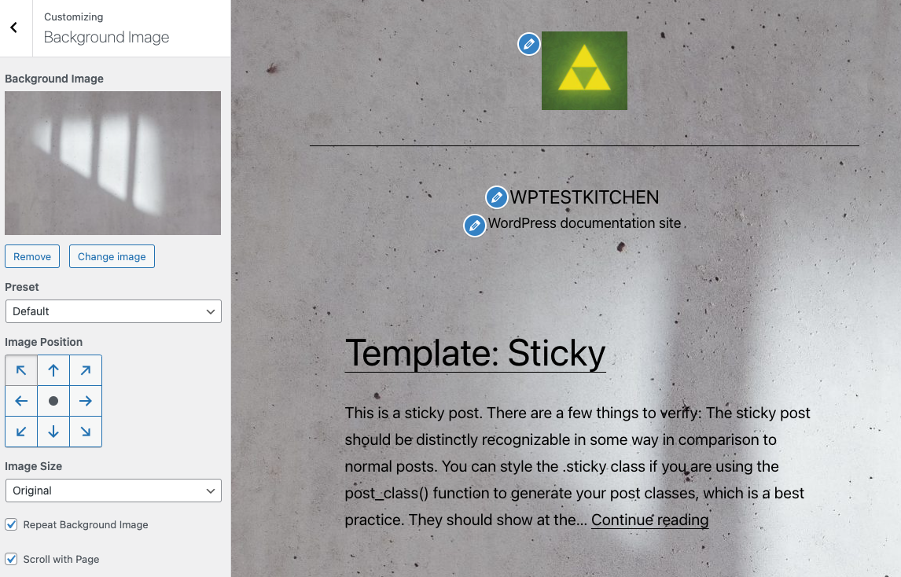

*Background Image screen*

-   **Select image** – Click this button to open Select Image dialog box. You can choose an image that is already in your [Media Library](../media-screens/media-library-screen.md), or upload image file from your local computer in Upload Files tab screen. Select the image and click Choose Image button. The Customizer will preview your site with updated background.

Once you add a background image you will get some more options:

-   **Remove** – Once an image is uploaded, if the image is no longer desired, use this button to remove the image. You will not be able to restore any customizations.
-   **Change Image** – Click this button to change the background image.
-   **Preset dropdown** – Under Preset, you can select how you want the background image to be displayed: default, fill screen, fit to screen, repeat, or custom.
-   **Image Position** – You can also select the background image position by clicking on the arrows under Image Position, to be positioned Left, Center, or Right . Clicking on center will align the image to the center of the screen.
-   **Image Size** – You can change the Image Size from the drop down menu to Fit to Screen, Fill Screen or keep it Original.
-   **Repeat Background Image** – Click the checkbox to repeat the background image across the page.
-   **Scroll with Page** – Click the checkbox to enable the background image to scroll with the page or display as fixed.

### Menus

This panel is used for managing the navigation menus for content you have already published on your site. You can create menus and add items for existing content such as pages, posts, categories, tags, formats, or custom links.

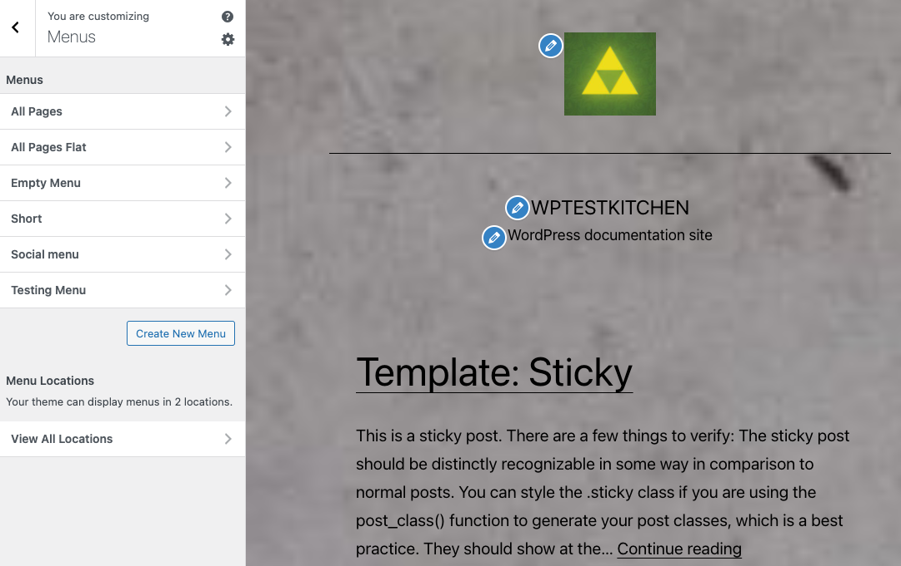

*Customizer Add Menu screen*

The [WordPress Twenty](../../../editing-and-design/themes/default-themes/twenty-fifteen/README.md) [Twenty-One](../../../editing-and-design/themes/default-themes/twenty-twenty-one/README.md) [theme](../../../editing-and-design/themes/default-themes/twenty-twenty-one/README.md) supports two menu locations, Primary Menu and Secondary Menu. From the pull down box, select the menu that will be presented in the location. If you have added support for [more navigation menus](appearance-menus-screen.md) in your theme, you will see more pull-down location options.

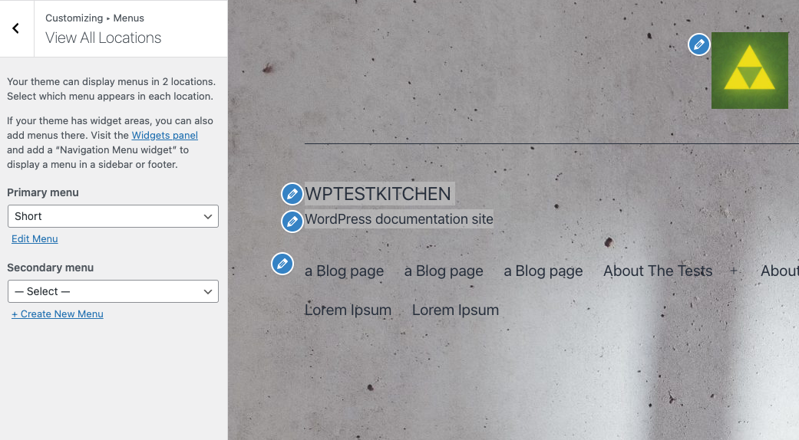

*Customizer Menu Locations*

### Widgets

WordPress 5.8 introduces blocks to the Widget Editor and lets you add any [block](../../../editing-and-design/block-editor/blocks/README.md) to the header, footer, sidebars and other widget areas in your theme using the all new Widgets Editor.

You can configure the Widgets via Appearance > Customize > Widgets menu and see your changes in live preview of the Customizer.

#### Adding Your Widgets

1.  Click the **Widget** menu in the Theme Customizer to access to the Widget Customize Screen.
2.  Click the **+** icon at the top of the Widget Area to open the list of available blocks.
3.  Search or find the block [you want to add](../../../editing-and-design/block-editor/working-with-blocks/adding-a-new-block.md) and click to select the block. The block is added to the widget area.
4.  Preview your site and you should see the new block in your Widget area.

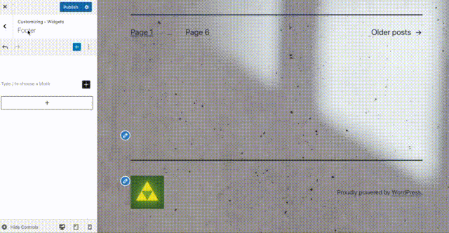

*Adding Widgets*

#### Configuring The Widgets

To reorder the Widgets within the Widget area, select the widget and click the **up** or **down** arrow from the Block toolbar.

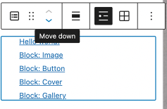

You can also rearrange the Widgets, by clicking and holding the six-dot-grid button in the Block toolbar and dragging the Widget blocks.

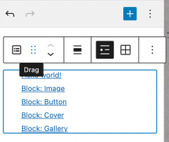

To customize the Widget features, click the three-dots button in the Block toolbar of the selected widget and select Show More Settings to open the Widget customization options.

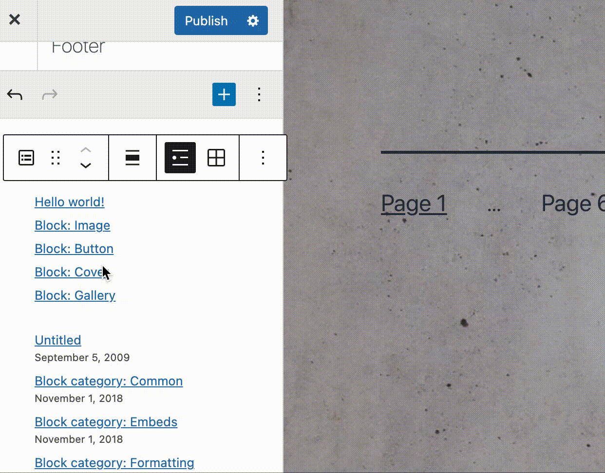

You can traverse the changes made in the Widget Area customizations using the Undo-Redo buttons in the Widget Menu.

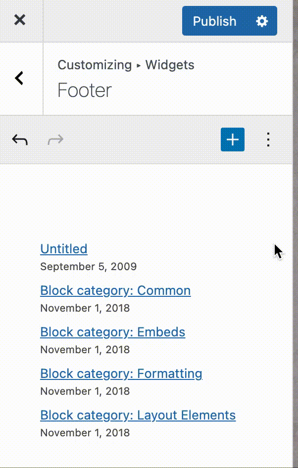

To remove the widget, click three-dots button in the Block toolbar of the selected widget and select **Remove** **block**.

Within a widget area, you can now select multiple Widgets using shift-click and delete the blocks or backspace to delete the blocks.

### Homepage Settings

You site’s home page can either contain your latest posts or display a static page or post.

-   **Your latest posts** – select this to show your latest posts in your home page
-   **A static page** – select either a Front page or Posts page. Refer [Creating a Static Front Page](../../writing-and-publishing/organizing-your-site/create-a-static-front-page.md) for more detail information and available combination.

### Excerpt Settings

This panel allows you to choose if the blog and archive pages should show the full content or only the summary. 
The default is summary. The search results page always shows the summary. When the summary is selected, only text will be displayed.

### Additional CSS

A panel that lets you add CSS code which will override the current theme.
