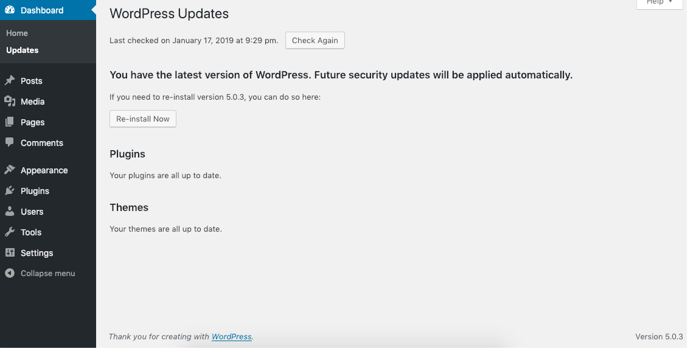

# Dashboard Updates screen

The **Dashboard Updates Screen**
provides the links necessary to install a ‘core’ WordPress upgrade
automatically, or to download the file necessary to complete a manual
upgrade.

In addition to the ‘core’ update process, this Screen provides
the ability to upgrade all plugins and themes, active or inactive, that
have available updates. For installs that have set the language to a
language different from English (United States), you can also install
translation updates.

*Dashboard > Updates when everything is up to date.*

## WordPress Updates

#### No Upgrade is Available

When visiting the **Dashboard Updates Screen**, if you are running the latest version of WordPress, you should see messages like this:

> [!NOTE]
> **Y**o**u have the latest version of WordPress. Future security updates will be applied automatically.** 
> *If you need to re-install version x.x, you can do so here or download the package and re-install manually:*

**Re-install now** – Click to to reinstall the current version. You should receive the following messages if the upgrade proceeds successfully:

> [!NOTE]
> *Downloading update from <https://wordpress.org/wordpress-x.x.zip>* 
> *Unpacking the core update* 
> *Verifying the unpacked files* 
> *Installing the latest version* 
> *Upgrading database* 
> *WordPress upgraded successfully*

**Download x.x** – Click this to download the zip file contain the latest version.

#### An Upgrade is Available

When visiting the **Dashboard Updates Screen**, and there is an WordPress upgrade available, you should see messages like this:

> [!CAUTION]
> *before upgrading, please backup your database and files.*

**Upgrade Automatically** – Press this button to begin the automatic upgrade process. The following messages will display during and upon completion of the upgrade:

> [!NOTE]
> *Downloading update from <https://wordpress.org/nightly-builds/wordpress-latest.zip>* 
> *Unpacking the core update* 
> *Verifying the unpacked files* 
> *Installing the latest version* 
> *Upgrading database* 
> *WordPress upgraded successfully*

**Download x.x** – Click this to download the zip file contain the latest version.

#### Once an Update is Completed

After a successful upgrade is achieved, it is a good time to review any new features about the new Version just installed.

## Plugins

#### No Plugins to Update

When visiting the **Dashboard Updates Screen**, if your plugins (active and inactive) are at the latest versions, you should see this message:

> [!NOTE]
> *Your plugins are all up to date.*

#### Update Plugins

When visiting the **Dashboard Updates Screen**, if there are updates available for one or more plugins (active and inactive), this message displays:

> [!NOTE]
> *The following plugins have new versions available. Check the ones you want to update and then click “Update Plugins”.*

**Update Plugins** – After checking Select All or one or more plugins, click this button to begin the automatic upgrade process. The following messages will display during and upon completion of the upgrade. Messages for each plugin being updated will display. This example shows Akismet being updated:

> [!NOTE]
> *The update process is starting. This process may take awhile on some hosts, so please be patient.*  
> *Enabling Maintenance mode…* 
> **Updating Plugin Akismet**  
> *Downloading update from [plugins](https://wordpress.org/plugins/akismet/).*  
> *Unpacking the update…* 
> *Installing the latest version.*  
> *Removing the old version of the plugin…* 
> *Plugin upgraded successfully.*  
> *Akismet updated successfully. Show/Hide Details.* 
> *Disabling Maintenance mode. All updates have been completed.*  
> **Actions:** *Return to Plugins page | Return to WordPress Updates.*

## Themes

### No Themes to Update

When visiting the **Dashboard Updates Screen**, if your themes (active and inactive) are at the latest versions, you should see this message:

> [!NOTE]
> *Your themes are all up to date.*

#### Update Themes

When visiting the **Dashboard Updates Screen**, if there are updates available for one or more themes (active and inactive), this message displays:

> [!NOTE]
> *The following themes have new versions available. Check the ones you want to update and then click “Update Themes”.* 
>  **Please Note:** *Any customization you have made to the Themes files will be lost. Please consider using child themes for modifications.*

**Update Themes** – After checking Themes (to Select All), or one or more themes, click this button to begin the automatic upgrade process. The following messages will display during and upon completion of the upgrade. Messages for each theme being updated will display. This example shows the WordPress Classic theme being updated:

> [!NOTE]
> *The update process is starting. This process may take awhile on some hosts, so please be patient.*  
> *Enabling Maintenance mode.*  
> **Updating WordPress.**  
> *Downloading update.*  
> *Unpacking the update…* 
> *Installing the latest version…* 
> *Removing the old version of the theme…* 
> *Theme upgraded successfully.*  
> *WordPress updated successfully. Show/Hide Details.*  
> *Disabling Maintenance mode.*  
> *All updates have been completed.* 
> **Actions**:*Return to Themes page | Return to WordPress Updates*

## Translations

#### No Translations to Update

When visiting the **Dashboard Updates Screen** on a WordPress install that is set to a different language then English (United States), you should see this message if translations are all up to date:

> [!NOTE]
> *Your translations are all up to date.*

#### Update Translations

If there are new translations available, this message is displayed:

> [!NOTE]
> *New translations are available.*

Below this text will be a button with the text “Update translations”.

When you click the update button, it will tell you which plugins are downloaded and installed. Plugins for WordPress Core will be installed in */wp-content/languages*, while the translations for plugins and themes will be installed in their subfolder under */wp-content/languages*. This example shows the translations for Twenty Fifteen anf Twenty Sixteen being updated for Dutch (nl_NL):

> [!NOTE]
> *Updating translations* 
> *Updating translation for Twenty Fifteen (nl_NL)…* 
> *Translation was successfully updated.* 
> *Updating translation for Twenty Sixteen (nl_NL)…* 
> *Translation was successfully updated.* 
> **Actions**:*Return to WordPress Updates* 
> **Actions**:*Return to WordPress Updates*

## Troubleshooting

**Problem:** If one of the following messages is received after electing to do the Automatic Upgrade:

> [!NOTE]
> *Downloading update .*  
> *Download failed.: Could not open handle for fopen() to latest wordpress.* 
> *I*n*stallation Failed*

or

> [!NOTE]
> *Download failed.: name lookup timed out*  
> *Installation Failed*

**Solution:** Confirm you are properly connected to the internet then do the Automatic Upgrade again.

**Problem:** After doing the upgrade, and received *WordPress upgraded successfully* message, but the following message still displays:

> [!NOTE]
> *An automated WordPress update has failed to complete – please attempt the update again now.*

**Solution:** Delete the **.maintenance** file found in the WordPress root/base folder, then do the Upgrade again.

**Problem:** After clicking on “automatic upgrade” you get a dialog box asking for “Connection Information.” And, no matter what you enter, you continue to get errors.

**Solution:**  Make sure that your entire wordpress directory is owned by the username under which your Apache server runs. For example, if your server runs as https, and your files live in /var/wordpress do a “chown -R apache.apache /var/wordpress.” Note that you might want to edit some permissions for security purposes, in particular a chmod 640 on wp-config.php, to protect access information to your database.

## Related Articles

-   [FAQ Installation](../../../overview/faq/faq-installation.md)
-   [Troubleshooting about upgrading](https://developer.wordpress.org/advanced-administration/upgrade/upgrading/#troubleshooting)
