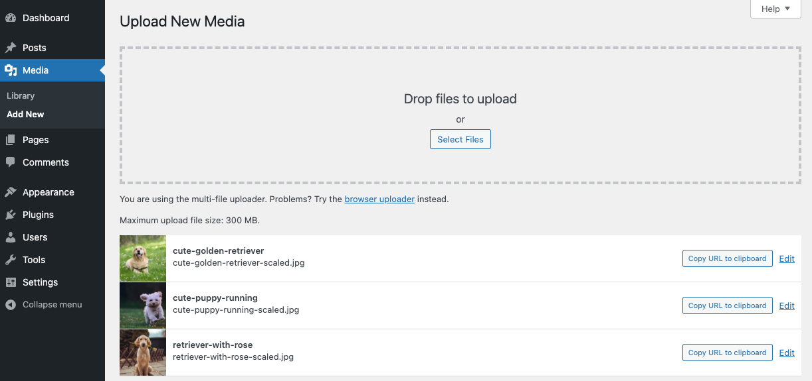
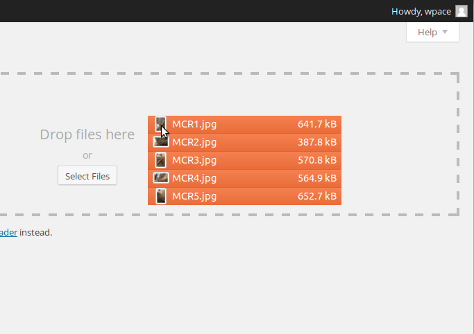
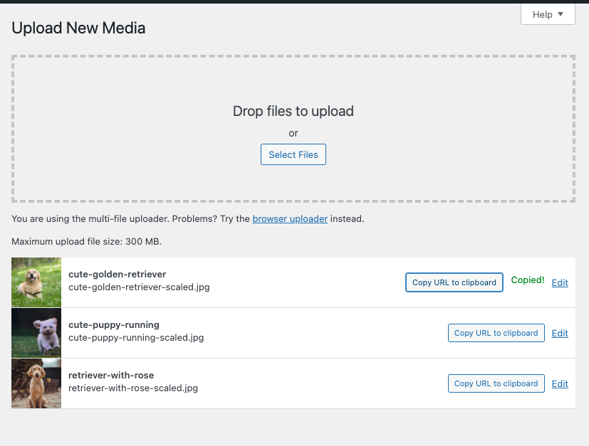

# Media Add New screen

The **Media Add New Screen** allows you
to upload Media (Images, video, files, etc.) for later use in your
posts and pages. This screen allows you to both add single items as
well as perform bulk uploads, if you wish to add more than one media
item to your Media Library.

### Upload New Media

Uploading media from your local computer into the Media Library is
quite simple. Two ‘uploader’ methods, Multi-File Uploader and Browser
Uploader, are provided. The Multi-File Uploader is the primary method
for adding media to the Media Library, but if doesn’t work then click
the “Browser Uploader” link to use the Browser Uploader.

*Media Upload screen*

You will also see a message displayed at the bottom of your view that indicates maximum upload size for files, as set by your hosting provider.

#### Multi-File Uploader

*Multi-File Upload*

-   **Drag-and-Drop** – If you are using a web browser that supports HTML5 then you will see an active upload area (indicated by a dashed border) where you can “drag-and-drop” files from your computer to this area to upload them to the Media Library. You can upload files one at a time, or you can add multiple media items by dragging and dropping a group of files in this area.
-   Select Files – If drag-and-drop is not working for you, click on the Select Files button, which will launch a file browser that allows you to find and select (by clicking) the files you want to upload. Multiple files can also be selected by holding down the Ctrl key (Cmd key on a Mac) and clicking on each file you wish to upload. After all the files are selected, click on the Open button to begin uploading.

As your files are uploaded, a status bar will be displayed next to each one to indicate progress.

When the uploading is complete, a thumbnail of the media is displayed. Once your upload is complete, you may click on the Edit link to edit and save the information about that media files (see the [Edit Media](../../media/edit-media.md) page for more information) if you wish.

You may also click on the ‘Copy URL to clipboard’ button to copy the URL of the file you uploaded.

#### Browser Uploader

Uploading via the Browser uploader:

-   **Browse** – Click this button, and then from the File Upload window, find and click the file to upload, then click the Open button. The Media file name will be placed in the text box to the left of the Browse button.
-   **Upload** – Once a Media file name is displayed in the text box to the right of the Browse button, click the Upload button to upload that Media. At that point the Media Library Screen is displayed.
-   **Cancel** – If the Upload is not working or is taking a prolonged period of time, click the Cancel button to cancel the Upload process.

## Further reading

-   [Edit Media](../../media/edit-media.md)
-   [Media library screen](media-library-screen.md)
-   [Settings Media Screen](../settings/settings-media-screen.md)
-   [Image Size and Quality](../../media/image-size-and-quality.md)
-   [Use Images](../../media/use-images.md)
-   [Use image and file attachments](../../media/use-image-and-file-attachments.md)
-   [Inserting Images into Posts and Pages (Block Editor)](../../media/inserting-images-into-posts-and-pages-block-editor.md)
-   [Inserting Images into Posts and Pages (Classic Editor)](../../../classic-wordpress/classic-editor/inserting-images-into-posts-and-pages-classic.md)
