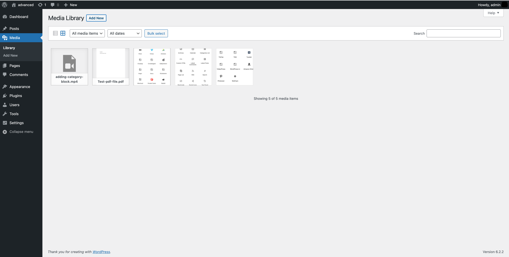
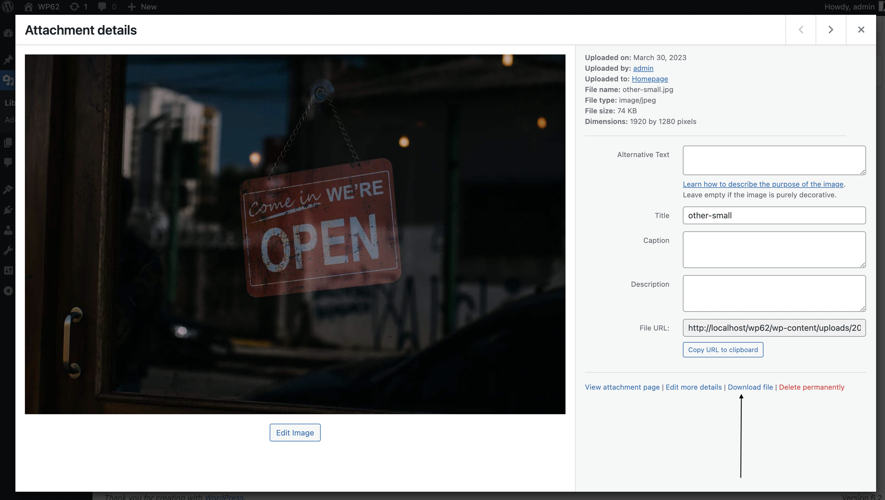
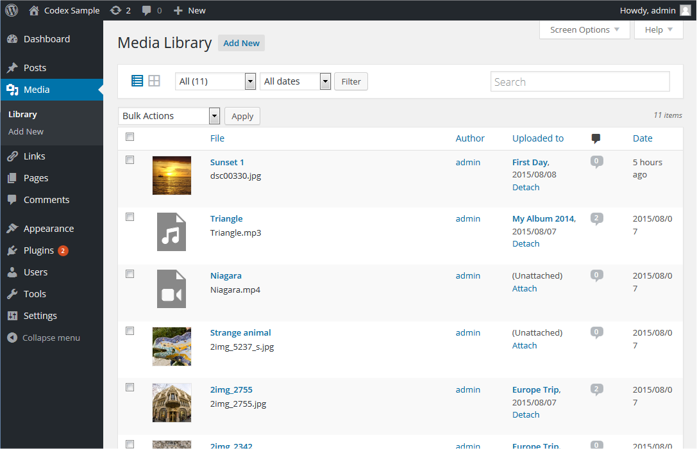
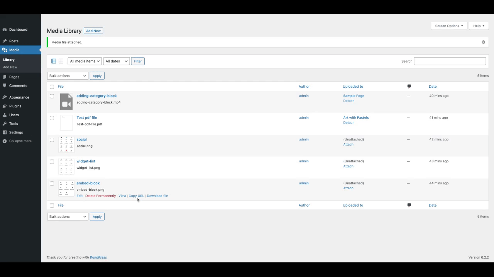
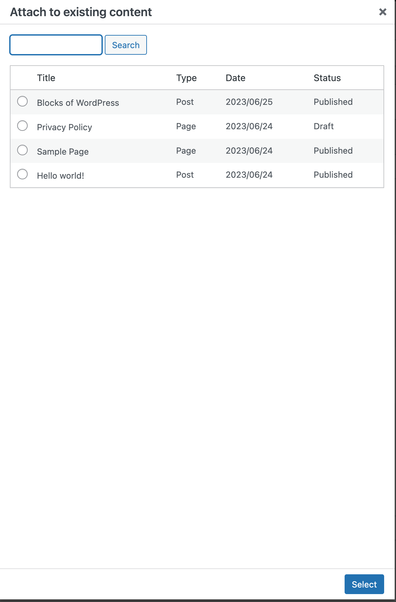

# Media Library screen

## Media →︎ Library

Media consists of the images, video, recordings, and files that you upload and use in your blog. Media is typically uploaded and inserted into the content when [writing a Post](../../writing-and-publishing/write-posts-classic-editor.md) or [writing a Page](../pages/pages-add-new-screen.md). Note that the Uploading Setting in the [Settings Media Screen](../settings/settings-media-screen.md) describes the location and structure of the upload directory (where your media files are stored). If you do need to upload Media, even if that Media is not related to a Post or Page, then you need to use the [Media Add New Screen](media-add-new-screen.md).

Visit the [Media add new screen](media-add-new-screen.md) to install new media by clicking the Add New link at the top of this screen or Select **[Media](../README.md#media-add-pictures-and-movies-to-your-posts) > [Add New](media-add-new-screen.md)** from the left side menu.

### [Media library](#media-library)

The Media Library Screen allows you to edit, view, and delete Media previously uploaded to your blog. Multiple Media objects can be selected for deletion. Search and filtering ability is also provided to allow you to find the desired Media.

Media Library provides two type of views. One is simple visual [Grid View](#media-library-grid-view) and another is conventional [List View](#media-library-list-view). Switch between these views using the icons to the left above the screen.

## [Media library grid view](#media-library-grid-view)

In Media Library Grid View, thumbnails of image, Audio icons and Movie icons are arranged in the grid.

*Grid view of media items*

### [Filtering options](#filtering-options)

At the top of Grid View, you can filter the media by media type and date:

**All media items**

This dropdown allows you to select, by media types such as Images, Audio and Video or Unattached to any Posts nor Pages, which Media are displayed in the Table of Media. By default, “All media items” are selected and all of your Media are displayed.

**All dates**

This dropdown allows you to select, by date, which Media are displayed in the Grid View. By default, “Show all dates” is selected and all of your Media are displayed.

To the right, is a Search box where you can enter a word, or series of words to search and display all the Media meeting your search words. The search results will be updated as you type.

### [Delete media](#delete-media)

To delete media items, click the Bulk Select button at the top of the screen. Select any items you wish to delete, then click the Delete Selected button. Clicking the Cancel Selection button takes you back to viewing your media.

### [Attachment details](#attachment-details)

In Media Library Grid View, clicking an Image thumbnail, Audio icon or Video icon will display an Attachment Details dialog, which allows you to preview media and make quick edits. Any changes you make to the attachment details will be automatically saved. You can also delete individual items and access the extended edit screen from the details dialog. 
Use the arrow buttons at the top of the dialog, or the left and right arrow keys on your keyboard, to navigate between media items quickly.

*Attachment details screen*

Attachment Details changes its appearance and information by media type. The left side of this dialog shows the Image, Audio player or Video player. The right side lists the following media file attributes and optional data. Some of them are editable from this dialog.

-   **Uploaded on** – The date when the media file was uploaded
-   **Uploaded by** – [author](../users/users-screen.md) who uploaded the Media.
-   **Uploaded to** – Title of the Post or Page that contains this Media. Click on the title to view that Post or Page in an edit Screen. If the Media was unattached to any Post or Page, this line does not appear.
-   **File name** – The name of the media file
-   **File type** – The MIME Type of media file
-   **File size** – The file size of the media file
-   **Dimensions** – (Image files only) The dimensions of image media
-   **Alt Text** – (Image files only) The alt text for the image, e.g. “The Mona Lisa” to describe the media. Used for accessibility.
-   **Title** – The name of the media. A title is often shown on attachment pages and galleries if themes or plugins are designed to display it.
-   **Caption** – A brief explanation of the media.
-   **Description** – An explanation of this particular media.
-   **File** **URL** – Read-only display of a direct link to the media file.
-   **Copy URL to clipboard** – Click to copy the URL of the file into the clipboard.
-   **Artist** – (Voice files only) Singer, composer or producer of this media.
-   **Album** – (Voice files only) Album title that includes this media.

At the bottom there are three link menus:

**View attachment page**

Shows the media in a simulated view of how the image would look when displayed in your Theme.

**Edit more details**

Displays the Edit Media Screen. See the [Edit Media](../../media/edit-media.md) for details on editing Media information.

**Download file**

Makes it easier for users to download their uploaded media by providing a download link on the attachment details screen and in the media modal.

**Delete permanently**

Deletes the media.

**Edit image**

(Image files only) Allows you to make edits such as rotate, scale, and crop. See the [Edit Image Screen](../../media/edit-media.md).

## [Media library list view](#media-library-list-view)

In Media Library List View, a table lists all of your Media, by row. The Media are listed with the newest uploaded Media first.

*List view for the items inside media library*

### [Table of media](#table-of-media)

The table of Media contains the following columns:

-   **[ ]** – This checkbox, when clicked (checked), ‘selects’ that particular Media to be processed by a Bulk Action.
-   **“thumbnail”** – There is no column heading for “thumbnail”, but a small image of the actual media is displayed in this column
-   **File** – Displayed in the form of a link, this is Title, the name of the media. Clicking the title link opens Edit Media Screen. See the [Edit Media](../../media/edit-media.md) for details on editing Media information. Below the Title, the actual name of the file that holds this particular Media is displayed.
-   **Author** – Displayed in the form of a link, this is the [author](../users/users-screen.md) who uploaded the Media. Clicking the author link causes all the Media authored by that user to be displayed in the Table of Media (thus allowing a Bulk Action to be applied to all Media for a given author).
-   **Uploaded to** – Uploaded to describes the title of the Post or Page that contains this Media and the date of that Post or Page. Click on the title to view that Post or Page in an edit Screen. If the Media was unattached to any Post or Page, an “Attach” link will appear and when clicked this Media can be attached to selected Posts or Pages. For more detail about selecting, see [Find Posts or Pages](#find-posts-or-pages). If the Media has been attached to more than one Post or Page, only the details of the first Post or Page will be displayed.
-   **Comment bubble** – Each Media row has a comment bubble with the number of comments for that Media. If a Media has any comments, then the number of comments is displayed in a bubble. Clicking on a blue comment bubble causes the [Comments Screen](../../comments/comments-screen.md) to be displayed to allow moderation of those comments.
-   **Date** – The date the Media was uploaded.

#### [Sortable columns](#sortable-columns)

Some column headings, such as the **File**, **Author**, **Uploaded to**, and **Date** headings, can be clicked to sort the Table of Media in ascending or descending order. Hover over the column title, e.g. **File**, to see the up arrow or down arrow. Click the heading to change the sort order.

#### [Page navigation](#page-navigation)

Under the Screen Options, the number of Media displayed per page is determined. If more than one page of Media is available, two double-arrow boxes to move to the first and last page are provided. Also two single-arrow boxes are displayed to move one page backward or forward. Finally, a box showing the current page number can be used to enter a page to directly display.

#### [Screen options](#screen-options)

The [Screen Options](../README.md#screen-options) allow you to choose which columns are displayed, or not displayed, in the underlying Table. Clicking on the Screen Options tab shows a list of the columns with a check-box next to each column. Check the box for each column you want displayed in the Table, or uncheck the box to not display that column. In addition, the number of Media items to display in the [Table of Media](#table-of-media) can be set. Click the Screen Options tab again to close the Screen Options.

#### [Search](#search)

Above the Table, to the right, is a Search box where you can enter a word, or series of words, and hit the Enter key to search and display all the Media meeting your search words.

### [Filtering options](#filtering-options-2)

At the top of List view, you can filter the media by media type and date:

**All**

This dropdown allows you to select, by media type such as Images, Audio and Video or Unattached to any Posts nor Pages, which Media are displayed in the [Table of Media](#table-of-media). By default, “All” is selected and all of your Media are displayed.

**All dates**

This dropdown allows you to select, by date, which Media are displayed in the [Table of Media](#table-of-media). By default, “All dates” is selected and all of your Media are displayed.

**Filter**

Clicking this button applies the settings you select in the dropdown.

### [Using selection, actions, and apply](#using-selection-actions-and-apply)

#### [Selection](#selection)

This Screen allows Bulk Actions to be performed on one or more Media selected in the Table. For Bulk Actions to be performed on multiple Media at once, those Media must be first **selected** via one of these methods:

-   **Select one Media at a time** – To select a Media, the checkbox to the left of the Media entry must be checked (clicked). It is possible to keep selecting more Media by checking their respective checkbox.
-   **Select all Media in given Table** – All Media in a given table can be selected by checking the checkbox in the Table’s title, or footer bar. Of course, unchecking the header or footer title bar checkbox will cause all entries in that Table to be unchecked (NOT selected).
-   **Reverse Selection** – A Reverse Selection means checked items become unchecked, and unchecked items become checked. A Reverse Selection is accomplished by holding the Shift key on the keyboard and clicking the header or footer title bar checkbox.

#### [Actions](#actions)

Actions describe the process to be performed on particular Media. There are two styles of Actions that will be referred to as *Bulk Actions* and *Immediate Actions*. The follow describes these Actions:

-   **Bulk actions** – These Actions can be performed on one, or more Media, at one time, if those Media have been previously [selected](#selection). Bulk Actions are available, when appropriate, as choices in the Bulk Actions pulldown box, above the Table. The only Bulk Action allowed is Delete Permanently.
-   **Immediate actions** – Immediate Actions are performed immediately, on an individual Media. Hovering the mouse cursor over the Media row reveals the Edit, Delete Permanently, and View options under the File column, in that Media row. Clicking on a Media Title will also initiate the Edit Action.

The available Actions are described below:

-   **Edit** – This Immediate Action displays the Edit Media Screen. This Action can be initiated by click on the Media Title. See the [Edit Media](../../media/edit-media.md) for details on editing Media information.
-   **Delete permanently** – This Action deletes the Media. Delete Permanently is available both as a Bulk Action, and an Immediate Action.
-   **View** – This Action presents the Media in a simulated view of how the image would look when displayed in your Theme. View is available only as an Immediate Action.
-   **Copy URL to clipboard** – When clicked, copies the absolute URL to clipboard. Tooltip will appear on success.
-   **Download file** – Downloads the original media file to your device. This makes easier for users to download their uploaded media by providing a Download row action to the Media List Table.
-   **Attach** – In Unattached filtered view, “Attach” action is displayed. By clicking this link, the media can be attached to selected Posts or Pages. For more detail about selecting, see [Find Posts or Pages](#find-posts-or-pages).

#### [Find posts or pages](#find-posts-or-pages)

*Copy URL in media items list view*

*Attach media items to content*

Clicking **Attach** link in the “Attached to” column or “Media” column when Unattached filtered view appears **Find Posts or Pages** dialogue box. From this dialogue box, you can select a Posts or Pages that the media should be attached to. Follow the steps:

1.  Search posts or Pages by keyword.
2.  Select the post/Page one wants to attach the media.
3.  Click the *Select* button.

#### [Apply](#apply)

After one or more Media are *selected*, and after a *Bulk* Action is specified, the **Apply** button performs the given Action on the selected Media.

-   **Apply** – Click the Apply button to execute the Bulk Action, specified in the Actions pulldown, on the selected Media. Remember, prior to executing Actions, one or more Media must be **selected**, as described before.

## [Further reading](#further-reading)

-   [Media Add New Screen](media-add-new-screen.md)
-   [Edit Media](../../media/edit-media.md)
-   [Settings Media Screen](../settings/settings-media-screen.md)
-   [Inserting Images into Posts and Pages (Block Editor)](../../media/inserting-images-into-posts-and-pages-block-editor.md)
-   [Inserting Images into Posts and Pages (Classic Editor)](../../media/inserting-images-into-posts-and-pages-classic.md)
-   [Use Images](../../media/use-images.md)
-   [Use image and file attachments](../../media/use-image-and-file-attachments.md)
-   [Image Size and Quality](../../media/image-size-and-quality.md)

## Changelog

-   Updated on 2023-06-27
    -   Changed the photo of media library grid view and the GIF for Actions
-   Updated on 2023-06-25
    -   Updated screenshots for media library grid view [because it was showing WordPress 4.0], Attachment details, find posts & pages.
    -   Updated GIF for Actions
    -   Added alt tag and caption for Media library list view image
    -   Added the paragraph Download file to the edit media page section
