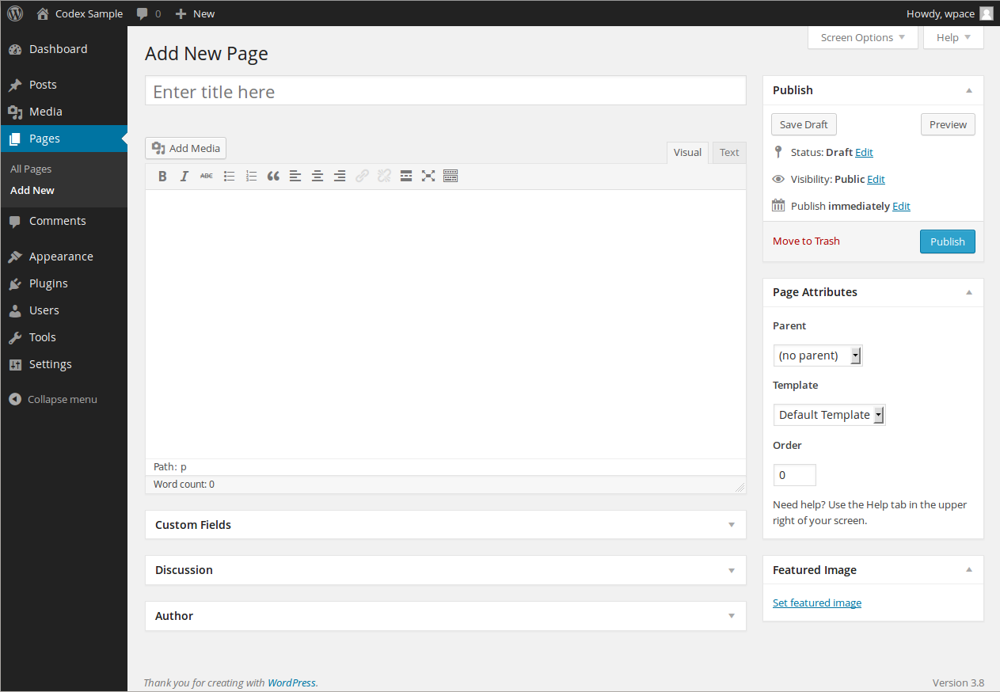

# Pages Add New screen

The Pages Add New Screen allows you to add new [Pages](../../writing-and-publishing/create-pages.md).

## Screen options

The [Screen Options](../README.md#screen-options) allow you to choose which modules are displayed, or not displayed, in the underlying screen. Clicking on the Screen Options tab shows a list of the columns with a checkbox next to each column. Check the box for each module you want displayed, or uncheck the box to not display that module. Click the Screen Options tab again to close the Screen Options. These options are saved so that you can customize how your own editing screen looks. So if modules such as Custom Fields, Discussion, Slug and Post Author are hidden from view use the Screen Options to expose those modules.

## Expanding, collapsing, and rearranging, modules

The modules, Publish, Page Attribute, Features Image and others, can be expanded, or collapsed, by clicking on the module title bar.

In addition, those modules can be moved by hovering the mouse cursor over the module title bar, when the mouse cursor changes to 4-arrows, hold the left-mouse button down, drag the module to where you want to place it, then release the mouse button (this is called drag-and-drop).

## Add new page

**Title**

The title of your page. You can use any words or phrases. Avoid using the same title twice as that will cause problems. You can use commas, apostrophes, quotes, hypens/dashes, and other typical symbols in the page like “About My Site – Here’s Lookin’ at You, Kid.” WordPress will clean it up for the link to the page, called the *slug*.

**Page editing area**

The blank box where you enter your writing, links, links to images, and any information you want to display on your site. You can use either the Visual or the Text view to compose your posts. For more on the Text view, see the [Visual](<https://codex.wordpress.org/Writing%20Posts#Visual_Versus%20Text_Editor>) [Versus](../../writing-and-publishing/write-posts-classic-editor.md#visual-versus-text-editor) [Text View](<https://codex.wordpress.org/Writing%20Posts#Visual_Versus%20Text_Editor>) article.

**Preview button**

Allows you to view the page before officially publishing it.

**Publish box**

Contains buttons that control the state of your page. The main states are Published, Pending Review, and Draft. A *Published* status means the page has been published on your blog for all to see. *Pending Review* means the draft is waiting for review by an editor prior to publication. *Draft* means the page has not been published and remains a draft for you. If you select a specific publish status and click the update page or Publish button, that status is applied to the page. For example, to save a page in the *Pending Review* status, click Edit link of Status and select Pending Review from the drop-down box, click OK to close the drop-down box and click Save As Pending button. (You will see all pages organized by status by going to Pages > All Pages). To schedule a page for publication on a future time or date, click “Edit” in the Publish area next to the words “Publish immediately”. You can also change the publish date to a date in the past to back-date pages. Change the settings to the desired time and date. You must also hit the “Publish” button when you have completed the page to publish at the desired time and date.

Visibility – This determines how your page appears to the world. Public pages will be visible by all website visitors once published. Password Protected pages are published to all, but visitors must know the password to view the page content. Private pages are visible only to you (and to other editors or admins within your site)

**Permalink**

After you save your page, the Permalink below the title shows the potential URL for the page, as long as you have [permalinks](../../writing-and-publishing/organizing-your-site/customize-permalinks.md) enabled. (To enable permalinks, go to Settings > Permalinks.) The URL is generated from your title. In previous versions of WordPress, this was referred to as the “page-slug.” The commas, quotes, apostrophes, and other non-HTML favorable characters are changed and a dash is put between each word. If your title is “My Site – Here’s Lookin’ at You, Kid”, it will be cleaned up to be “my-site-heres-lookin-at-you-kid” as the title. You can manually change this, maybe shortening it to “my-site-lookin-at-you-kid”.

**Save**

Allows you to save your page as a draft / pending review rather than immediately publishing it. To return to your drafts later, visit Pages > All Pages from dashboard, then click your page title from the list.

**Publish**

Publishes your page on the site. You can edit the time when the page is published by clicking the Edit link above the Publish button and specifying the time you want the page to be published. By default, at the time the page is first auto-saved, that will be the date and time of the page within the database.

**Parent**

Parent page controls how deep your page hierarchy goes.

**Template**

Some Themes have custom templates you can use for certain pages that might have additional features or custom layouts. If so, you’ll see them in this dropdown menu.

**Order**

Page order to sort the list of Pages.
