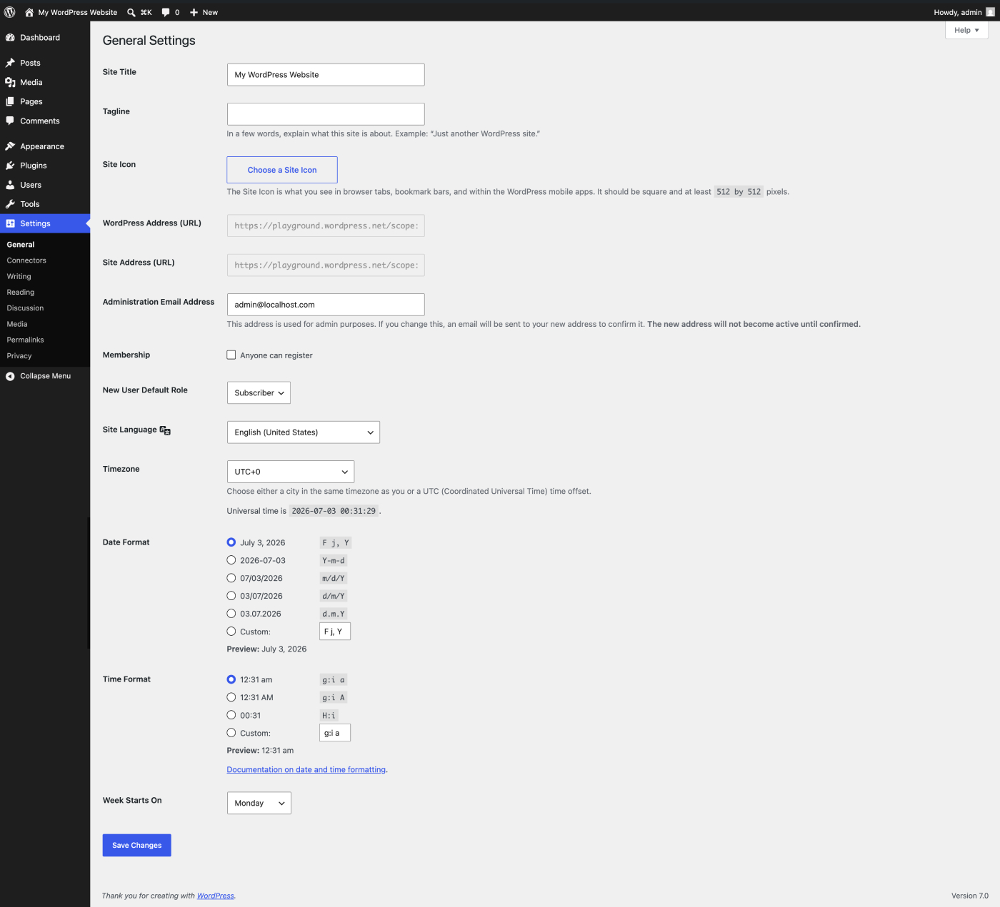

# Settings General screen

This Settings General Screen is the default Screen in the [Settings Administration Screen](../README.md#settings-configuration-settings) and controls some of the most basic configuration settings for your site: your site’s title and location, who may register an account at your site, and how dates and times are calculated and displayed.

## General Settings

### Site title

Enter the name of your site (or blog) here. Most themes will display this title, at the top of every page, and in the reader’s browser titlebar. WordPress also uses this title as the identifying name for your [Syndication](../../../overview/where-to-start/introduction-to-blogging.md#syndication) feeds.

### Tagline

In a few words, explain what your site is about. Your sites’ slogan, or tagline, might be entered here. A tagline is short phrase, or sentence, used to convey the essence of the site and is often funny or eye-catching. The default tagline is an empty string.

### WordPress Address (URL)

Enter the full URL of the directory containing your WordPress core application files (e.g., wp-config.php, wp-admin, wp-content, and wp-includes). For example, if you installed WordPress into a directory called “blog”, then the WordPress address would be `http://example.net/blog` (where example.net is your domain). If you installed WordPress into your web root, this address will be the root URL `http://example.net`. WordPress will trim a slash (`/`) from the end. If you defined the **WP_SITEURL** constant in your [`wp-config.php`](https://codex.wordpress.org/Editing_wp-config.php#WordPress_address_.28URL.29) file, that value will appear in this field and you will not be able to make changes to it from the WordPress administration screen.

### Site Address (URL)

Enter the address you want people to type in their browser to reach your WordPress site. This is the directory where WordPress’s main `index.php` file is installed. The *Site address (URL)* is identical to the *WordPress address (URL)* (above) unless you are [giving WordPress its own directory](https://developer.wordpress.org/advanced-administration/server/wordpress-in-directory/). WordPress will trim a slash (`/`) from the end. If you defined the **WP_HOME** constant in your [`wp-config.php`](https://codex.wordpress.org/Editing_wp-config.php#Blog_address_.28URL.29) file, that value will appear in this field and you will not be able to make changes to it from the WordPress administration screen.

### Administration Email Address

Enter the email address WordPress should use for site administration notifications.

This address may receive notifications about:

-   comment moderation,
-   user registration,
-   site updates and maintenance,
-   recovery mode and fatal errors,
-   plugin or theme issues,
-   and other administrative events.

The Administration Email Address is different from the email address associated with an individual user account.

Changing this setting does not change the email address used to log in to WordPress. User account email addresses can be managed under Users → Profile.

When you change the Administration Email Address, WordPress sends a confirmation email to the new address. The new address does not become active until the confirmation link in that email is clicked. Until then, the existing administration email address remains active.

After saving changes, WordPress displays a notice indicating that the new email address is pending confirmation.

If you do not receive the confirmation email:

-   Check your spam or junk folder.
-   Allow a few minutes for delivery.
-   Verify that your hosting provider or email service is configured to send WordPress emails correctly.
-   Test whether your site can send email successfully.
-   Consider using an SMTP plugin or transactional email service if emails from your site are not being delivered reliably.

If your site was originally set up by a developer or agency, verify that the Administration Email Address points to an address your organization can access. Recovery mode and critical error notifications are sent to this address.

If email delivery problems continue, contact your hosting provider or system administrator.

### Membership

**Anyone can register** – Check this checkbox if you want anyone to be able to register an account on your site.

### New User Default Role

This drop-down box allows you to select the default [Role](../../users-roles-and-profiles/roles-and-capabilities.md) that is assigned to new users. This Default [Role](../../users-roles-and-profiles/roles-and-capabilities.md) will be assigned to newly registered members or users added via the [Administration](../README.md) > [Users](../README.md#users-your-blogging-family)  > [Users Screen](https://codex.wordpress.org/Users_Screen). Valid choices are [Administrator](../../users-roles-and-profiles/roles-and-capabilities.md#administrator), [Editor](../../users-roles-and-profiles/roles-and-capabilities.md#editor), [Author](../../users-roles-and-profiles/roles-and-capabilities.md#author), [Contributor](../../users-roles-and-profiles/roles-and-capabilities.md#contributor), or [Subscriber](../../users-roles-and-profiles/roles-and-capabilities.md#subscriber).

### Site Language

The WordPress dashboard language.

### Timezone

From the drop-down box, choose a city in the same timezone as you. For example, under America, select New York if you reside in the Eastern Timezone of the United States that honors daylight savings times. If you can’t identify a city in your timezone, select one of the **Etc GMT** settings that represents the number of hours by which your time differs from [Greenwich Mean Time](https://en.wikipedia.org/wiki/Greenwich_Mean_Time). Click the **Save Changes** button and the [UTC time](https://en.wikipedia.org/wiki/Coordinated_Universal_Time) and “Local time” will display to confirm the correct Timezone was selected.

### Date Format

The format in which to display dates on your site. The Date Format setting is intended to be used by theme designers in displaying dates on your site, but does not control how the date is displayed in the Administrative Screens (e.g. Manage Posts). Click the **Save Changes** button and the “Output” example below will show the current date in the format entered. See [Formatting Date and Time](../../writing-and-publishing/organizing-your-site/customize-date-and-time-format.md) for some of the formats available.

### Time Format

The format in which to display times on your site. The Time Format setting is intended to be used by theme designers in displaying time on your site, but does not control how the time is displayed in the Administrative Screens (e.g. Write Post edit of timestamp). Click the **Save Changes** button and the “Output” example below will show the current time in the format entered. See [Formatting Date and Time](../../writing-and-publishing/organizing-your-site/customize-date-and-time-format.md) for some of the formats available.

### Week Starts On

Select your preferred start date for WordPress calendars from the drop-down box. Monday is the default setting for this drop-down, meaning a monthly calendar will show Monday in the first column. If you want your calendar to show Sunday as the first column, then select Sunday from the drop-down.

### Save Changes

Click the **Save Changes** button to ensure any changes you have made to your Settings are saved to your database. Once you click the button, a confirmation text box will appear at the top of the page telling you your settings have been saved.

## Changelog

-   Updated 2026-07-03
    -   Updated content for the Administration Email Address section. Props @dpknauss
    -   Updated Settings General screenshot
-   Updated 2024-08-24
    -   Spacing/typos
    -   Tagline default of empty string added
