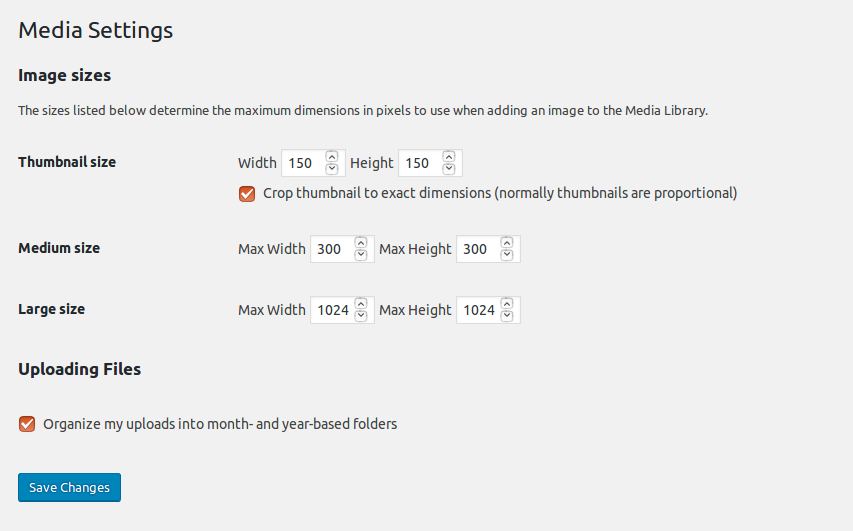

# Settings Media screen

The **Settings Media Screen** controls the various settings related to images and other media that are used in writing posts and pages.

You will need php-gd (GD graphics library) installed on your server to use this feature.

## Media Settings

### Image sizes

The sizes listed below determine the maximum dimensions in pixels to use when inserting an image into the body of a post.

-   **Thumbnail size** – Enter the **Width** and **Height**
    -   **Crop thumbnail to exact dimensions (normally thumbnails are proportional)** – checkbox
-   **Medium size** – Enter the **Max Width** and **Max Height**
-   **Large size** – Enter the **Max Width** and **Max Height**

### Uploading Files

Default settings used for during the media upload process when writing a post.

-   **Organize my uploads into month- and year-based folders** – Check this box if you wish to organize your uploads into folders based on the year and the month of the upload. As of 3.5, wp-content/uploads is the default path setting for the uploads folder. Assuming this is your path setting, if you check this box, a file uploaded in June of 2018 would be placed into the wp-content/uploads/2018/06 folder. Note: At the time of the actual upload, WordPress will automatically create the folders, such as wp-content/uploads/2018 and wp-content/uploads/2018/06, as long as your wp-content folder is writeable.

### Save Changes

Click the **Save Changes** button to ensure any changes you have made to your Settings are saved to your database. Once you click the button, a confirmation text box will appear at the top of the page telling you your settings have been saved.

## Further reading

-   [Image Size and Quality](../../media/image-size-and-quality.md)
-   [Media Add New Screen](../media-screens/media-add-new-screen.md)
-   [Media library screen](../media-screens/media-library-screen.md)
-   [Edit Media](../../media/edit-media.md)
-   [Use Images](../../media/use-images.md)
-   [Use image and file attachments](../../media/use-image-and-file-attachments.md)
-   [Inserting Images into Posts and Pages (Block Editor)](../../media/inserting-images-into-posts-and-pages-block-editor.md)
-   [Inserting Images into Posts and Pages (Classic Editor)](../../../classic-wordpress/classic-editor/inserting-images-into-posts-and-pages-classic.md)
