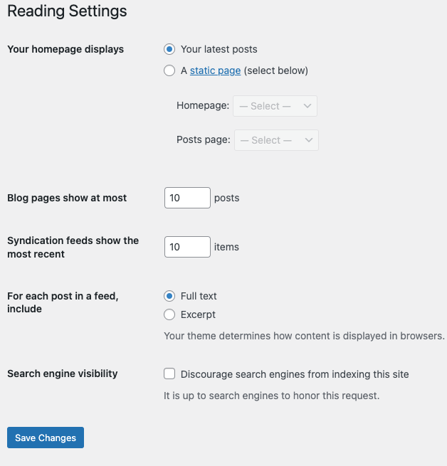

# Settings Reading screen

The options in the **Reading Settings** **Screen** are few in number, but still important. You can decide if you want your latest [posts](../../../classic-wordpress/classic-editor/write-posts-classic-editor.md) or a “static” [P](https://codex.wordpress.org/Pages)[a](../../writing-and-publishing/create-pages.md)[ge](https://codex.wordpress.org/Pages) displayed as your website’s front (home) page. You can also adjust how many posts are displayed on that home page. In addition, you can adjust [syndication feed](../../../overview/where-to-start/wordpress-glossary.md#feed) features to determine how the information from your site is sent to a reader’s web browser or other applications.

## Reading Settings

Your website’s front page uses these settings to determine if your posts or a “static” [Page](../../writing-and-publishing/create-pages.md) is displayed as your website’s home (main) page. These settings work only if you have one or more [Pages](../../writing-and-publishing/create-pages.md) defined. Please note: static front page plugins and other ‘posts display’ control/restriction plugins may affect how these features work!



*Reading Settings*

-   **Your latest posts** – Check this radio button so your latest posts are displayed on the blog’s home page. Remember, the number of posts you display is controlled by the “Blog pages show at most” setting.
-   **A static page (select below)** – Check this radio button to have a “static” [Page](../../writing-and-publishing/create-pages.md) be displayed as your blog’s home page. At the same time, choose the Page that will display your actual Posts. The Home page and Posts page cannot be the same.

-   **Home page** – In the drop-down box, select the actual [Page](../../writing-and-publishing/create-pages.md) that you want displayed as your front page. If you do not select a choice here, then effectively your blog will show your posts on both the blog’s front page and on the **Posts page** you specify. If you would like to create a static home page template file, **do not** name it home.php, otherwise you will encounter problems when you try to view the “blog”/”posts” section of your site. To get around this, just name it anything but home.php, for example, myhome.php
-   **Posts page** – In the drop-down box, select the name of the [Page](https://codex.wordpress.org/Pages) that will now contain your Posts. If you do not select a Page here, your Posts will only be accessible via other navigation features such as category, calendar, or archive links. Even if the selected Page is password protected, visitors will NOT be prompted for a password when viewing the Posts Page. Also, any Template assigned to the Page will be ignored and the theme’s *index.php* (or *home.php* if it exists) will control the display of the posts.

See [Creating a Static Front Page](../../writing-and-publishing/organizing-your-site/create-a-static-front-page.md) for more detail.

**Blog pages show at most**

-   **[X] posts** – Enter the number of posts to be displayed, per page, on your site.

**Syndication feeds show the most recent**

-   **[X] posts** – Enter the number of posts people will see when they download one of your site’s feeds.

**For each article in a feed, show**

Determines whether or not the feed will include the full article or just an excerpt.

-   **Full text** – Click this radio button to include the full content of each post.
-   **Excerpt** – Click this radio button to include an excerpt of the post. This could save bandwidth.

**Encoding for pages and feeds *(Removed as of [Version 3.5.0](https://codex.wordpress.org/Version_3.5))***

Enter the character encoding to set the choice of languages in which you, the other authors, and your commenters, can write. The default (and safe choice) is “UTF-8” (see [Unicode](https://codex.wordpress.org/Glossary#Unicode)), as that encoding supports a wide variety of languages. If you wish to use some other character encoding (for example you have imported or will import articles written using a different character encoding) then specify that here. Caution should be used when changing this field as it may change the way information is displayed on your blog. For a more in-depth article on character encoding see [Wikipedia:Character encoding](http://en.wikipedia.org/wiki/Character_encoding).

**Search Engine Visibility *(New as of [Version 3.5.0](https://codex.wordpress.org/Version_3.5))***

Note: the Settings → Privacy screen has been removed from WordPress as of [Version 3.5.0](https://codex.wordpress.org/Version_3.5)).

Check the *Discourage search engines from indexing this site* box to ask search engines not to index this site. When the option is checked, the following happens:

-   (Since [Version 5.3](https://make.wordpress.org/core/2019/09/02/changes-to-prevent-search-engines-indexing-sites/)) Causes “&lt;meta name=’robots’ content=’noindex,nofollow’ />” to be generated into the &lt;head> &lt;/head> section (if wp_head is used) of your site’s source, causing search engine spiders to ignore your site.
-   (Till Version 5.2) Causes hits to robots.txt to send back:

```
User-agent: *
Disallow: /
```

**Note:** The above only works if WordPress is installed in the site root and no robots.txt exists.

-   Stops pings to ping-o-matic and any other RPC ping services specified in the [Update Services](settings-writing-screen.md#update-services) of [Administration](../README.md) > [Settings](../README.md#writing) >[Writing](settings-writing-screen.md). This works by having the function privacy_ping_filter() remove the sites to ping from the list. This filter is added by having add_filter(‘option_ping_sites’,’privacy_ping_filter’); in the default-filters. When the generic_pingfunction attempts to get the “ping_sites” option, this filter blocks it from returning anything.

-   Hides the [Update Services](settings-writing-screen.md#update-services) option entirely on the [Administration](https://codex.wordpress.org/Administration_Screens) > [Settings](../README.md#writing) > [Writing](settings-writing-screen.md) screen with the message “WordPress is not notifying any Update Services because of your blog’s privacy settings.”

-   Allows normal visitors.

\*Note: *Neither of these options blocks access to your site — it is up to search engines to honor your request.*

### Save Changes

Click the **Save Changes** button to ensure any changes you have made to your Settings are saved to your database. Once you click the button, a confirmation text box will appear at the top of the page telling you your settings have been saved.
