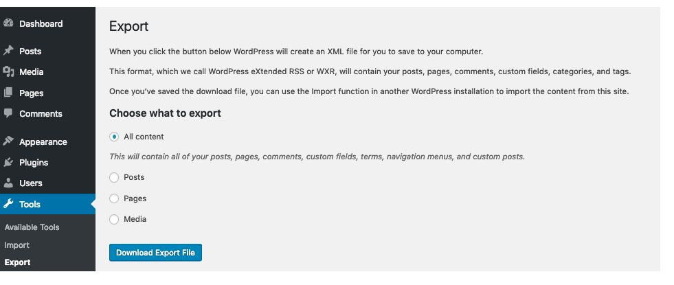

# Tools Export screen

## Tools → Export

Exporting your WordPress data (posts, pages, custom post types, comments, custom fields, categories, tags, custom taxonomies, and users) is sometimes necessary and useful. If you are moving to a new host or just want a backup of your site data, then Exporting your site is the answer. Once the export file is created, that file can be used for import by the [Tools Import Screen.](https://wordpress.org/support/articles/tools-import-screen/)

The **Tools Export Screen** is quite simple–just specify the desired Filters, if any, you wish to apply, and then click the Download Export File button to save that file to your local computer.

## Export

When you click the Download Export File button, WordPress will create an XML file for you to save to your computer.

This format, which is called and WordPress eXtended RSS or WXR
file, will contain your posts, pages, custom post types, comments,
custom fields, categories, tags, custom taxonomies, and users.

Once you’ve saved the download file, you can use Administration > Tools > Import > WordPress at another WordPress site to import this data

### Filters and Other Options

-   **All content** – export all of your posts, pages, comments, custom fields, terms, navigation menus, and custom posts.
-   **Posts** – check this radio button to expose additional filtering when exporting posts.
-   Categories – select only one category with this pulldown or leave at All Categories.
-   Authors – select a specific author from the pulldown or leave at All Authors.
-   Date range – select both the starting and ending post date to include in export.
-   Status – select the post status (e.g. Published) to export or leave at All Status.
-   Pages – check this radio button to expose additional filtering when exporting pages.
-   Authors – select a specific author from the pulldown or leave at All Authors.
-   Date range – select both the starting and ending page date to include in export.
-   Status – select the page status (e.g. Published) to export or leave at All Status.
-   Download Export File – click this button and the file, with any filters selected, will be created and you will be asked to save that file to your local computer.
