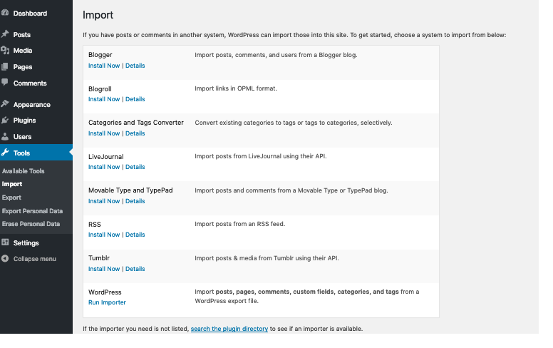

# Tools Import screen

Importing data into your WordPress blog is many times, necessary and
useful. If you are moving from another host, or just to start your blog
anew, then import data into your blog may be the answer.

Remember that [Importing Content](https://developer.wordpress.org/advanced-administration/wordpress/import/) has explicit details about most of the import choices listed below.

*Tools – import screen*

If you have posts or comments in another system, WordPress can import those into this blog. To get started, choose a system to import from below:

**Blogger**

Import posts, comments, and users from a Blogger blog.

**Blogroll**

Import links in OPML format. If not already installed this will direct you to install the WordPress.org OPML Importer.

**Categories to Tags Converter**

Convert existing categories to tags, selectively.

**LiveJournal**

Import posts from a LiveJournal XML export file.

**Movable Type and TypePad**

Import posts and comments from a Movable Type or Typepad blog.

**RSS**

Import posts from an RSS feed.

**Tumblr**

Install the Tumblr importer to import posts & media from Tumblr using their API.

**WordPress**

Import posts, comments, custom fields, pages, and categories from a WordPress export file.
