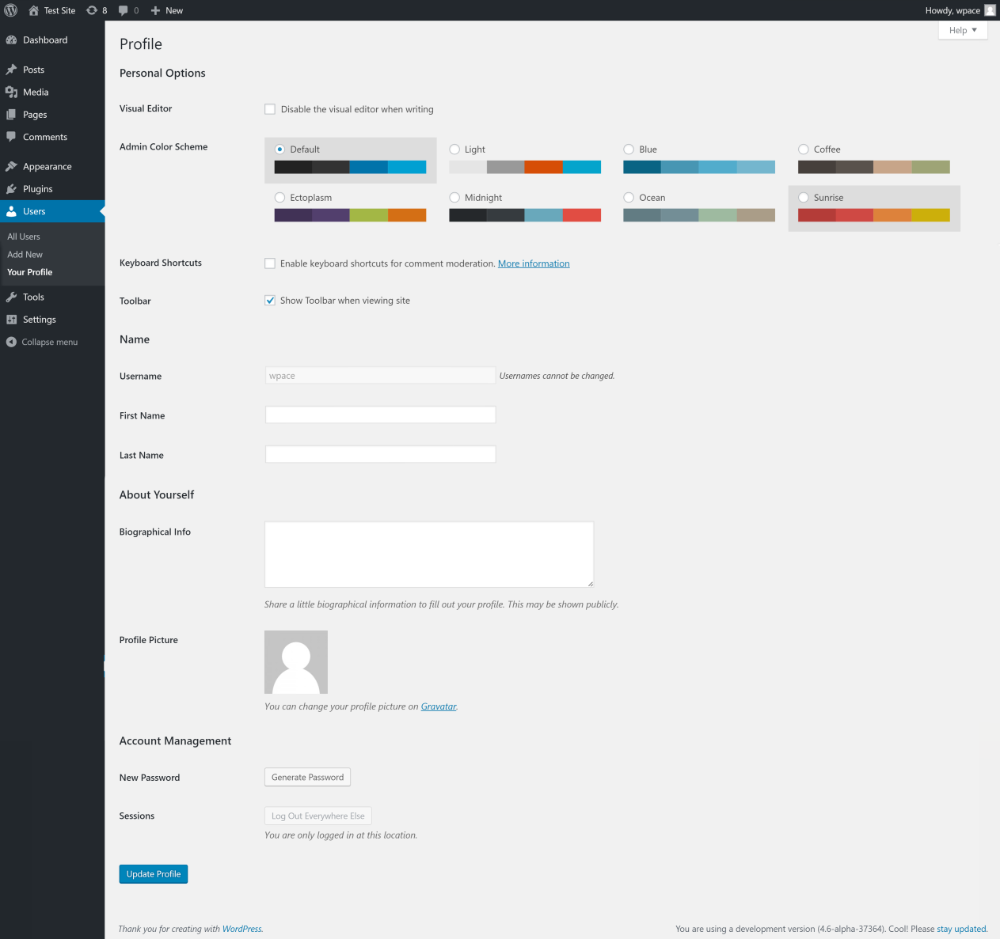
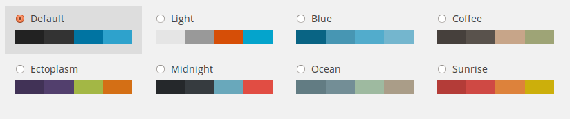

# Users Your Profile screen

## Users → Your Profile

The [Your Profile Screen](users-your-profile-screen.md) is accessible from both the main navigation menu under [Users](../README.md#your-profile) and by clicking on your name link at the top of the WordPress screen. Here you can specify your name and how it will be displayed on your site, your e-mail address (for administrative purposes), other personal information, and personal options.

*Your Profile Screen*

## Your Profile and Personal Options

The only pieces of information WordPress requires you to include in your Profile are your **e-mail address** and a **nickname**. It should be noted that WordPress requires your email address only for your blog’s administration purposes. The email address is never sent to any other site (not even to the people at WordPress headquarters), and it is never displayed on your site (unless you put it there manually). Only the other *registered* users of your blog have access to the e-mail address you provide. Also, remember that each user’s email address must be unique.

**Note**: it is *possible* for a theme to display your e-mail address (and the e-mail addresses of your other registered users) on your site, since the [`the_author_meta('user_email')`](<https://codex.wordpress.org/Template%20Tags/the_author_meta>) template tag can be used for such purposes. This would be a poorly conceived theme, however, if it didn’t inform you of that before you downloaded it. None of the themes included with WordPress display any e-mail address anywhere on the public side of your site by default.

All of the other personal information asked for here is *optional*, and, again, it is never sent to any other site or person. It *may* be displayed on your site, however, depending on the theme you use, so you should test things out with your particular theme if you’re at all paranoid (and a bit of paranoia regarding your personal information is healthy). See [the_author](https://developer.wordpress.org/reference/functions/the_author) and related template tags for information on how to display this information on your site (and, consequently, how to ensure the theme you use does/does not display any of this information). Typically, themes only display the information you enter in the **Display name publicly as** field, however the Authors username is also often included in the URL (for Author Archives) and in the CSS classes for per-author targeted stylings.

**Personal Options :**

-   **Visual Editor** – Checking this box **Disables the visual editor when writing**, and uses the plain HTML editor.
-   **Syntax Highlighting** – Checking this box **Disable syntax highlighting when editing code**.
-   **Admin Color Scheme** – Check this radio button next to the color scheme desired for the [Administration Screens](../README.md). The left two colors are menu background colors and the right two are roll-over colors.

*Color scheme of Administration Screens*

-   **Keyboard Shortcuts** – Checking this box **Enables keyboard shortcuts for comment moderation**. Keyboard shortcuts are designed to allow you to rapidly navigate and perform actions on comments. The [Keyboard Shortcuts article](../../../classic-wordpress/classic-editor/keyboard-shortcuts-classic-editor.md) describes the various shortcuts in detail.
-   **Toolbar** – Check the box to display the [Toolbar](https://codex.wordpress.org/Toolbar) when you are viewing your site.
-   **Language** – You can select the language you wish to use while using the [Administration Screen](../README.md) without affecting the language site visitors see.

**Name :**

-   **Username** – You cannot edit your Username because it is used as your Username during the login process. Even an [Administrator](../../users-roles-and-profiles/roles-and-capabilities.md) cannot change your Username. Usually, no one else ever needs to see your Username.
-   **First name** – Enter your first name in this text box.
-   **Last name** – Enter your last name in this text box.
-   **Nickname** – Enter the nickname as it is a required for every user. It may be the same as your **User Name** or it can be different. If you don’t supply a Nickname, then the **User Name** will be placed in this field.
-   **Display name publicly as** – Select, from the drop-down, how your name is cited on your blog. This defaults to your first and last name. You can choose from several of the above pieces of information: **Nickname**, **Login** name, **First Name**, **Last Name**, “**First Last**“, or “**Last First**“. If you prefer “**Last, First**“, insert a comma after your last name in the **Last Name** text box above and choose the last option from this dropdown.

**Contact Info :**

-   **E-mail** – All users are required to list an e-mail address in their respective Profiles. The E-mail address must be unique for each user. Your blog will use this address to notify you of new comments to your posts and for other administrative purposes. To reiterate what was said above, only other registered users of your blog will have access to this e-mail address. It is *never* sent anywhere.
-   **Website** – Enter your website address.

**About Yourself :**

-   **Biographical Info** – Enter a short description or profile of yourself here. This optional information can be displayed by your theme if so configured by the theme author. See [`the_author_meta('description')`](<https://codex.wordpress.org/Template%20Tags/the_author_meta>) template tag.
-   **Profile Picture** – Your picture in [Gravatar](../../../overview/where-to-start/wordpress-glossary.md#gravatar) is shown here. To change it, access to the https://en.gravatar.com/. See also [Using Gravatars](../../users-roles-and-profiles/use-gravatars.md).

**Account Management :**

-   **Generate Password** – You can click this button to generate a new password for the account. This will show you a new field with the generated password. If you choose to change this password, a checkbox will appear to confirm that you want to use a weak password. You can check this box to confirm that you want to use your own password instead of a secure one.
-   **Strength Indicator** This indicates if the password you entered is Very Weak, Weak, Medium, or Strong (displayed in green). The stronger the password the more secure your login. Hint: The password should be at least seven characters long. To make it stronger, use upper and lower case letters, numbers and symbols like *!”?$%^&)*.
-   **Log Out Everywhere Else** – You can click this button to log out of other devices, such as your phone or a public computer.

### Update Profile

Remember to click this button to save the changes you have made to your Profile and Personal Options. After clicking this button you should see a splash message at the top of the screen saying User Updated. If you don’t see that message, then your changes are not saved!
