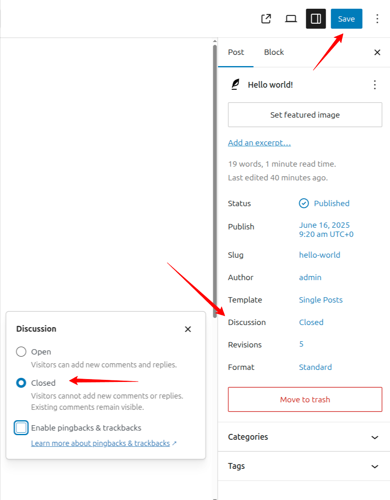
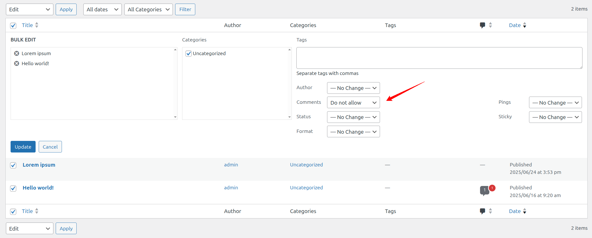

# Comment moderation

Comment moderation is a feature in WordPress that allows you to prevent comments from appearing on your site without your express approval. Moderation can be very useful in addressing [Comment Spam](understand-comment-spam.md), but it has more general applications as well. If you would like to learn more about comment spam, see [Fighting Comment Spam](understand-comment-spam.md#fighting-comment-spam).

## How moderation works

WordPress runs a number of tests on each new comment before posting it to your blog. If a comment fails one of these tests, it is not displayed immediately on the site but is placed in a queue for **moderation**, the process of manual approval or deletion by the blog’s administrator.

## Controlling moderation

You can control which comments get held for moderation on your [Settings Discussion Screen](../administration-screens/settings/settings-discussion-screen.md) page, which is located under [Settings](../administration-screens/README.md#settings-configuration-settings) → [Discussion](../administration-screens/README.md#discussion).

If you would like every comment to be held for moderation, check the **Comment must be manually approved** option, listed under **Before a comment appears**.

If you would like to send suspicious comments to the moderation queue, while letting innocent comments through, you will need to specify a set of rules for determining which comments are suspicious. These rules are specified on the [Settings](../administration-screens/README.md#settings-configuration-settings) → [Discussion](../administration-screens/README.md#discussion) > Comment Moderation.

The first option is to hold comments for moderation if they contain an unusually large number of hyperlinks. Most normal comments contain at most one or two links while spam comments often have a large number. Look at your own comments and set this to a value that makes sense for your audience. (Note: In version 1.5.2, and possibly others, if you do not put a number in the comment moderation links box, in other words, if this box is completely blank, all anonymous comments (and possibly others) are sent to the Manage Comments SubPanel for moderation, even if the Discussion Options Subpanel has no restrictions set.)

The second option is to specify a set of **moderation keys** which, if present in any part of the comment, will cause it to be held for moderation. These keys are specified one per line in the large text area, which is blank by default. Moderation keys can include Spam Words, swear words, [IP addresses](../../overview/where-to-start/wordpress-glossary.md#ip-address), and [Regular Expressions](http://en.wikipedia.org/wiki/Regular_expression).

When you add a new moderation key, it’s a good idea to test its validity by checking previous comments. Simply use the link entitled **Check past comments against moderation list**, which is located underneath the text box containing moderation keys. This asks WordPress to check previous comments and tell you which ones would be flagged for moderation under your new set of keys.

Of course this means that there may be a lot of comments that you don’t want on your site caught in the moderation queue, and in this case we’ve tried to make it as easy as possible to manage large numbers of comments quickly. See the articles on [Fighting Comment Spam](understand-comment-spam.md#fighting-comment-spam) for more information and resources.

## Comment moderation emails

When a comment is held for moderation, WordPress can send an email notification. This is controlled by the **A comment is held for moderation** checkbox, found under Settings > Discussion > Email me whenever.

When this setting is enabled, the notification is sent to the site’s administration email address, as configured under Settings > General. If the post author has permission to edit comments and holds at least an Editor role, they will also receive the notification. Post authors with the default Author role do not have comment moderation rights and will not receive a notification email.

If the post author’s email address matches the site administration email address, only one email is sent.

## Comment blocking

The box marked **Disallowed Comment Keys** works in exactly the same way as the comment moderation box, except that comments that match these words will be **deleted immediately** and ***without notification***. So be careful! Genuine comments could be deleted without you ever knowing they were there.

## Disable comments on post

If you want to prevent visitors from leaving comments on a specific post, WordPress allows you to disable comments either individually or in bulk. Here are the steps to do it:

**Single post**:

1.  Go to **Posts**.
2.  Hover over the post title and click **Edit**.
3.  In the post editor, locate the **Discussion**.
4.  Choose **Closed**.
5.  Click **Save** to save changes.

**Bulk post**:

1.  Go to **Posts**.
2.  Check the boxes next to the posts you want to edit.
3.  Choose **Edit** from the Bulk actions dropdown, then click **Apply**.
4.  In the bulk edit interface, set **Comments** to *Do not allow*.
5.  Click **Update**.

## Managing incoming comments

Once you start receiving comments on your site, you can check the status of comments quickly by looking at the dashboard, the admin bar, or the left navigation menu. When you log in, the dashboard’s “Activity” box will show you the status of your comments. Hover over a comment to see your moderation options. From “Activity – Comments” you can approve, reply, edit, mark as spam, or trash comments. Alternatively, you can look to see if there is a number next to the comment bubble in the admin bar or “Comments” in the left navigation. This number represents how many pending comments require your attention.

### Moderating comments with the comment screen

![WordPress comment moderation panel displaying a comment from a user named ‘blogreader.’ The entry shows the user’s avatar, username, website (example.com), email (blogreader@example.com), and IP address (192.168.0.5). The comment, submitted on 2013/12/16 at 8:18 am, reads: ‘By default anybody can leave comments without logging in.’ Below the comment are moderation options: Approve, Reply, Quick Edit, Edit, Spam, and Trash. On the right, the comment is shown as a response to the post titled ‘Hello world!,’ with a link to ‘View Post.’](../../assets/images/2023/08/comment_pending_numbered_smaller.png)

WordPress makes moderating your users’ comments a simple process. The [Comments Screen](comments-screen.md) lays out the basic information about each comment and lets you decide what to do with it.

1.  [Commenter Gravatar](../users-roles-and-profiles/use-gravatars.md)
2.  Commenter Name
3.  Commenter Website URL
4.  Commenter Email Address
5.  Commenter IP Address
6.  [Time and Date](../writing-and-publishing/organizing-your-site/customize-date-and-time-format.md) Comment was submitted
7.  Comment Text
8.  Comment Moderation Options. You can approve, spam or trash a comment with one click. Reply, Quick Edit or Edit will open up a new screen for you to write a reply to the comment or edit the comment.
9.  Post Name
10. Number of Comments on the Post, Link to View Post

### Bulk edit comments

Like the posts and Pages screens, the Comments screen supplies a Bulk Action drop-down box. Select the comments you want to edit, and then select Unapprove, Approve, Mark as Spam, or Move to Trash from the drop-down and click “Apply.”
