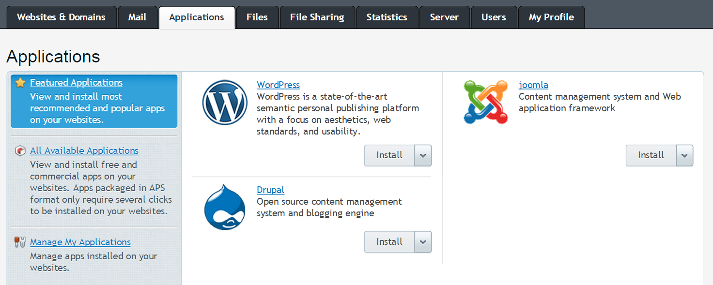
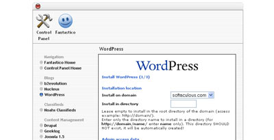
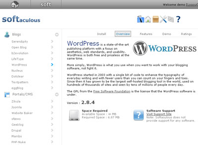

# Use automated installation

Although WordPress is very easy to install, you can use one of the one-click auto-installers typically available from hosting companies. The most popular auto-installers, [APS](https://codex.wordpress.org/Installing_WordPress#APS_.28Plesk.29), [Fantastico](https://codex.wordpress.org/Installing_WordPress#Fantastico), [Installatron](https://codex.wordpress.org/Installing_WordPress#Installatron), and [Softaculous](https://codex.wordpress.org/Installing_WordPress#Softaculous) are described here.

## APS (Plesk)

If you’re using the Plesk control panel, you have two options: one-click quick install or custom install which allows you to configure things like installation path or database prefix. Both these options are available regardless of whether you have [WordPress Toolkit](http://www.plesk.com/#solutions) enabled or not. However, special security measures are applied during installation only if WordPress Toolkit is enabled. If you don’t have WordPress Toolkit, your WordPress installations will have the same security as manual WordPress installs.

1.  Log in to your Plesk account and go to Applications tab. The Featured Applications screen will open.
2.  Click **Install** next to WordPress if you want a one-click quick install, or click the drop-down arrow next to Install and click **Custom** if you want to change installation parameters.
3.  If you chose quick installation, no need to do anything else, as your WordPress blog has already been installed. If you chose custom installation, change the settings you want and click **Install**.

## Fantastico

1.  Log in to your cPanel account and click on the **Fantastico** (or Fantastico Deluxe) option.
2.  Once you enter Fantastico, on the left hand side there is a Blogs category under which you will find WordPress. Click on it.
3.  Click on the **New Installation** link in the WordPress Overview.
4.  Fill in the various details and click **Submit**.
5.  That’s it, you are done!

-   [Fantastico Home Page](http://www.netenberg.com/fantastico.php)

## Installatron

Installatron is a one-click web application installer that enables WordPress and other top web applications to be instantly installed and effortlessly managed. WordPress installations managed by Installatron can be updated (manually or automated), cloned, backed up and restored, edited to change installation parameters, and more.

Many web hosting providers include Installatron through their web hosting control panel. If Installatron is not available from your provider, you can use Installatron directly from Installatron.com.

Here’s how to install WordPress through your web hosting provider’s control panel:

1.  Log in to your web host’s control panel, navigate to “Installatron,” click **WordPress**, and choose the **Install this application** option.
2.  Change any of the install prompts to customize the install. For example, you can choose a different language for WordPress.
3.  Click the **Install** button to begin the installation process. You will be redirected to a progress page where you can watch as WordPress is installed within a few seconds to your website.

Here’s how to install WordPress using Installatron.com:

1.  Navigate to [Installatron WordPress](http://installatron.com/wordpress) and choose the **Install this application** option.
2.  Enter your hosting account’s FTP or SSH account information, and then enter MySQL/MariaDB database information for a created database. For increased security, create a separate FTP account and MySQL/MariaDB database for your WordPress installation.
3.  Change any of the install prompts to customize the install. For example, you can choose a different language for WordPress.
4.  Click the **Install** button to begin the installation process. You will be redirected to a progress page where you can watch as WordPress is installed within a few seconds to your website.

-   [Installatron Home Page](http://www.installatron.com/)

## Softaculous

1.  Log in to your host and look for Software/Services.
2.  In Softaculous, there is a Blogs category. Collapse the category and WordPress will be there. Click on it.
3.  You will see an Install TAB. Click it.
4.  Fill in the various details and submit.
5.  That’s it, you are done!

-   [Softaculous Home Page](http://www.softaculous.com/)
