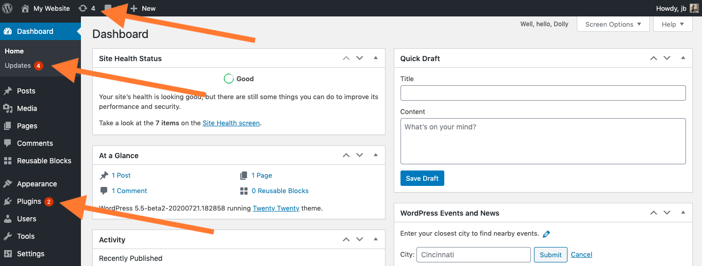
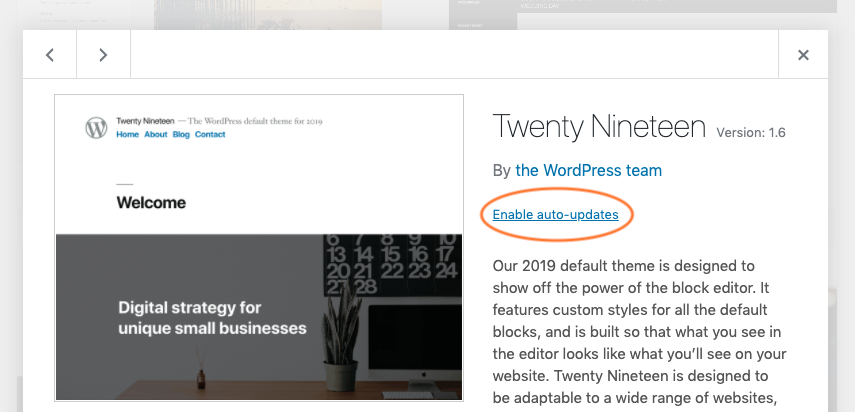
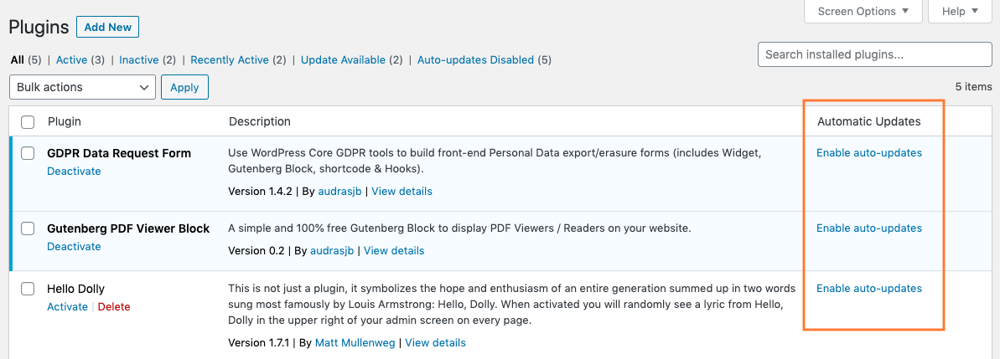
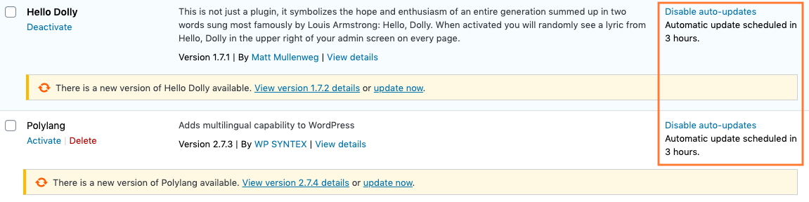
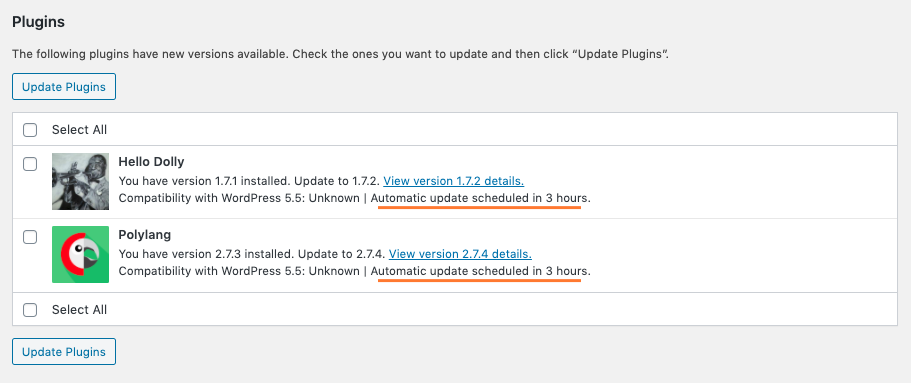
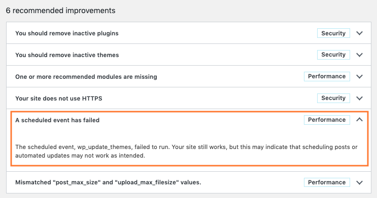

# Plugin and themes auto-updates

To keep your WordPress site secure, you should always update your plugins and themes to the latest version.

When a new version of a plugin or theme is available, an alert bubble is displayed in your WordPress Admin Menu and the corresponding theme or plugin is highlighted on Themes and Plugins Screens.

There are several places where you can manage themes or plugins updates:

-   WordPress, Plugins, Themes and Translations updates can be managed on the Updates Screen located in Dashboard > Updates sub menu.
-   Themes updates can be managed on the Appearance Screen.
-   Plugins updates can be managed on the Plugins Screen.

 

> [!NOTE]
> **Since [WordPress 5.5](https://wordpress.org/documentation/wordpress-version/version-5-5/), websites Administrators can manually opt-in for automatic updates theme by theme and plugin by plugin.**

## Enable auto-updates for themes

On the Appearance Screen, click on a theme thumbnail. In the theme modal, right below the author of the theme, an “Enable auto-updates” action link is available. Click on this action link to enable auto-updates for this specific theme.

Once enabled, auto-updates can be disabled at any time, using the same toggle link.

Themes auto-updates have to be enabled/disabled theme by theme.

## Enable auto-updates for plugins

Navigate to Plugins Screen. For each plugin, there is an “Automatic update” column with an action link used to enable/disable auto-updates plugin by plugin.

Click on this action link to enable auto-updates for each specific plugin.

Once enabled, auto-updates can be disabled at any time, using the same toggle link.

### Bulk enable/disable plugins auto-updates

Plugins auto-updates can be bulk enabled or disabled for several plugin at one time by using the bulk action selector. Select plugins using the checkbox located in the first column of the plugins list table and use the bulk action selector located on the top of the table to enable or disable auto-updates. Then click on the “Apply” button to bulk enable/disable auto-updates for the selected items.

<video controls preload="metadata" src="https://wordpress.org/documentation/files/2020/07/helphub-update-bulk-plugins.mp4"></video>

## When do Themes and Plugins auto-updates happen?

By default WordPress runs auto-updates twice per day. If updates are available for plugins or themes with auto-updates enabled, the time until the next scheduled update will be displayed below the enable/disable auto-updates action link.

The time until next auto-updates is also displayed in the Dashboard > Updates Screen for both Themes and Plugins:

## Email notifications after plugins and themes auto-update attempts

By default WordPress sends email notifications to website owners to inform them that plugins and themes were automatically updated. These email notifications are sent when:

-   One or more plugins or themes successfully auto-updated
-   One or more plugins or themes failed to auto-update
-   Some plugins or themes were successfully auto-updated, and some of them failed

## Advices & Troubleshooting

### Perform regular automatic backups of your website

Before enabling auto-updates on your plugins and themes, you may want to make sure you’re able to rollback to a previous version of your website in case things go wrong.

Various plugins exist to take automatic scheduled backups of your WordPress database and files. This helps to manage your backup collection easily. You can find automatic backup plugins in the **Plugin Browser** on the WordPress Administration Screens or through the [WordPress Plugin Directory](https://wordpress.org/plugins/).

-   [List of Backup Plugins](https://wordpress.org/plugins/tags/backup)

### Auto-updates are not available

If auto-updates controls are not available on your Plugins/Themes Admin Screens, please check you are running WordPress version 5.5 or more. Plugins and themes auto-updates were introduced in WP 5.5.

If you are running WordPress 5.5 or more and those controls are still unavailable, it probably means the feature was partially or completely deactivated by your hosting company or by a plugin.

### Auto-updates are not working

Depending on your server, your installation or on the plugins your website is running, auto-updates scheduling may not work correctly. Indeed, they rely on WordPress Cron tasks to actually perform the update.

To check if WordPress Cron tasks are running correctly, go to Tools > Site Health and search for any error message.

## More resources

-   Developer note: [Controlling plugin and theme auto-update interface in WordPress 5.5](https://make.wordpress.org/core/2020/07/15/controlling-plugin-and-theme-auto-updates-ui-in-wordpress-5-5/)
-   Plugins and Themes auto-updates [core merge announcement](https://make.wordpress.org/core/2020/05/02/merge-announcement-plugins-themes-auto-updates/)
