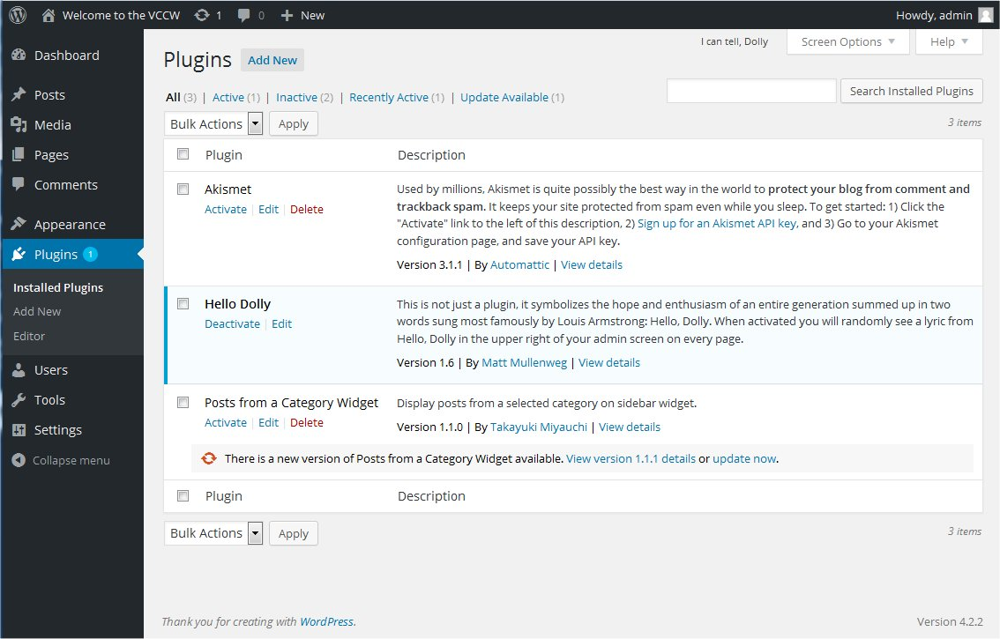
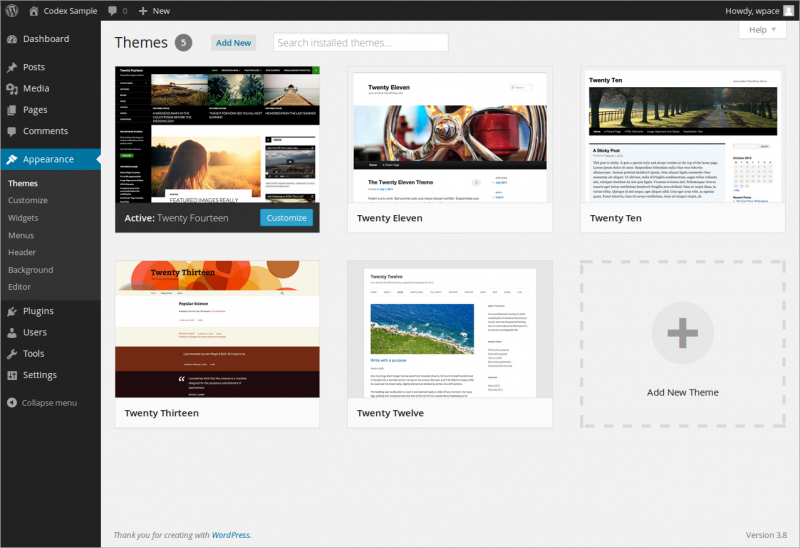

# WordPress Housekeeping

## Cleaning Your WordPress House

Just as with your house, WordPress requires a little housekeeping once in a while to keep it working right. Here is a list of things you should do on a [regularly scheduled basis](wordpress-site-maintenance.md) to keep your WordPress site running smoothly.

## Upgrade WordPress

If a new release of WordPress is out, we recommend that you [upgrade](updating-wordpress.md). These new releases often include [new and improved features](https://wordpress.org/about/features/) and fixes. It is recommended to check in with WordPress for updates and upgrades at least every three months, six months at the most. Check [WordPress.org](https://www.wordpress.org/) or [WordPress Downloads](https://wordpress.org/download/) for latest version available.

## Plugins

[Plugins](../administration-screens/plugins/introduction-to-plugins.md) are an exciting feature of WordPress. They add functions and features to your WordPress site such as adding customized post listings to featuring a local weather forecast on your site.

With the hundreds of plugins available, it’s fun to test drive them, trying out different ones to see what they will do, if you need them, and if they really add to your site or clutter things up. Once in a while, you should do a little housekeeping on your plugins.

### Upgrade Plugins

Every three to six months, check for the latest plugin version. This is easy to do from the [Administration](../administration-screens/README.md) > [Plugin](../administration-screens/README.md#plugins-add-functionality-to-your-blog) Screen. If an update is available, WordPress will notify you with a banner below the plugin. Just click the “upgrade automatically” link, or click the “Download” link if you would prefer to upgrade manually.

*Administration Plugins Screen*

### Delete Old or Unwanted Plugins

To uninstall a WordPress Plugin:

1.  Go to **[Plugins](../administration-screens/README.md#plugins-add-functionality-to-your-blog)** screen.
2.  Find the Plugin you wish to deactivate and uninstall.
3.  Click Deactivate.
4.  Click Delete.

The Plugin will initiate the deactivation and deletion.

Most WordPress Plugins have an option to completely uninstall themselves, though not all. If you wish to remove a WordPress Plugin permanently:

1.  Check the WordPress Plugin instructions in the **Details** readme file on how to properly uninstall the Plugin.
2.  If the WordPress Plugin required the addition of code to the WordPress Theme, manually edit the Theme files to remove it.
3.  Deactivate the Plugin and remove it manually through your FTP program.
    1.  Login to the site via your FTP Program.
    2.  Go to the Plugin directory and find where the Plugin is installed.
    3.  Delete the WordPress Plugin folder and/or files from your server.

### New Plugins

WordPress plugins are being added constantly. Every three to six months search the Internet or visit the [WordPress plugins repository](https://wordpress.org/plugins/) to see if there are any new plugins available that will improve your site. There might be a new plugin that will do what one of your older plugins do.

## Theme Housekeeping

Just like plugins, many users love test driving all the different [WordPress Themes](../../editing-and-design/themes/work-with-themes.md) available. Some users might have twenty or more Themes in their theme list. If you aren’t using them, why not do a little housekeeping on your themes?

*Appearance Themes Screen*

To remove a theme from your WordPress site:

1.  Log in to the WordPress [Administration Screen](../administration-screens/README.md).
2.  Select the [Appearance screen,](../administration-screens/README.md#appearance-change-the-look-of-your-blog) then [Themes](../administration-screens/README.md#themes).
3.  Select Theme Details for the theme you want to remove.
4.  Select Delete near the bottom-right corner.

### Get a New Theme

Tired of your old theme’s look? Maybe it’s time to do a little presentation housekeeping and change the look of your WordPress site. Thanks to WordPress’s support for [themes](../../editing-and-design/themes/work-with-themes.md), changing your site’s look is easy.

Check out the various resources for [WordPress Themes](../../editing-and-design/themes/work-with-themes.md). If you find one you like, install it and then activate it.

Don’t worry, your old theme will still be there. Test drive the new one for a while. You can always go back to the old one. If you are really determined to turn your theme housekeeping efforts into some serious work, check out the article on [Theme Development](https://developer.wordpress.org/themes/) to create your own unique theme.

## Unwanted Images

Many users upload a lot of graphics to their site that they end up never using. If you find yourself with a lot of unused graphics and images, consider going through them and cleaning house by deleting them.

If you aren’t sure you will never need them again, but you aren’t using them now and want to remove them from your site if server site space is limited, move them to a folder in your hard drive WordPress folder called *backupimages* or something similar and store them there, *just in case*.

## Database Optimization

Over time, your WordPress database can generate what’s called “overhead.” This condition is similar to a defragmented hard drive. There are some plugins that optimize your database (e.g. [WP-Sweep](https://wordpress.org/plugins/wp-sweep/))

## Maintenance Schedule

In the article, [Lessons: WordPress Site Maintenance](wordpress-site-maintenance.md), we cover website maintenance, but take a moment now to go through this list of WordPress housekeeping chores and add them to your calendar so you can clean up your site on a regular basis, keeping your WordPress site a lean and clean site to visit.
