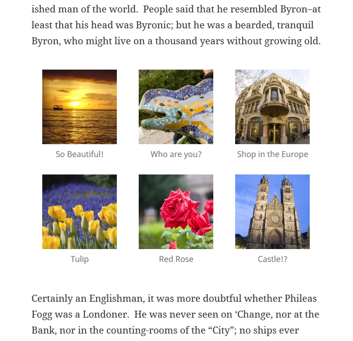
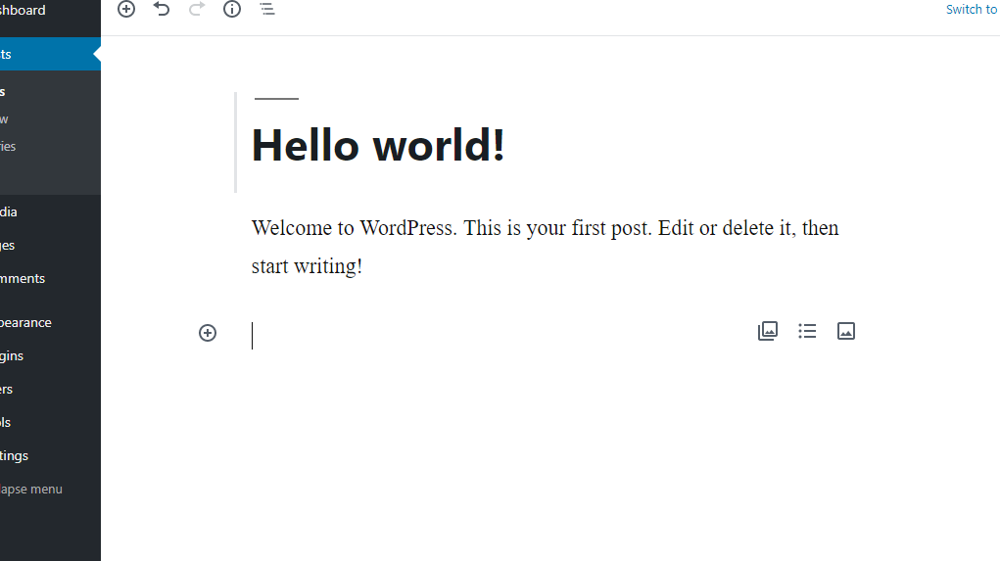
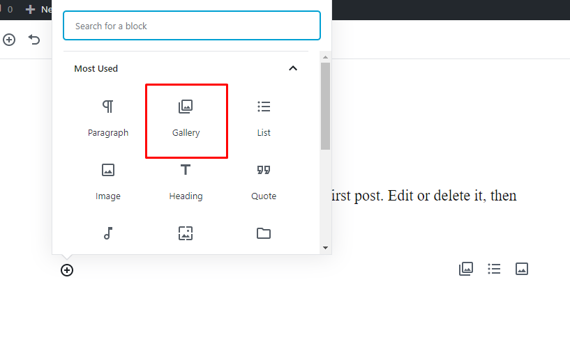
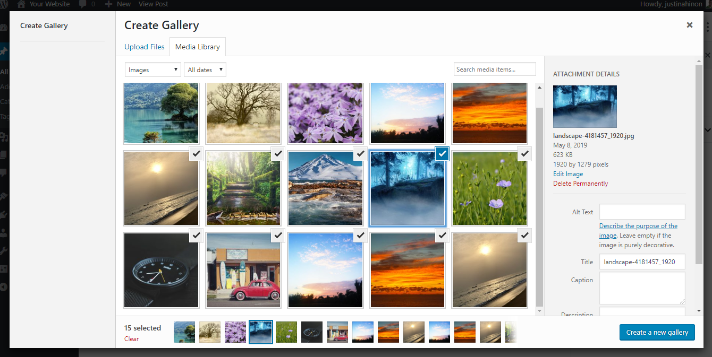
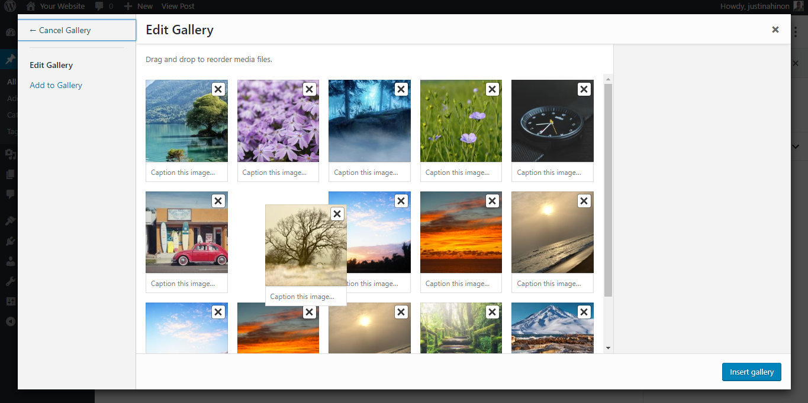
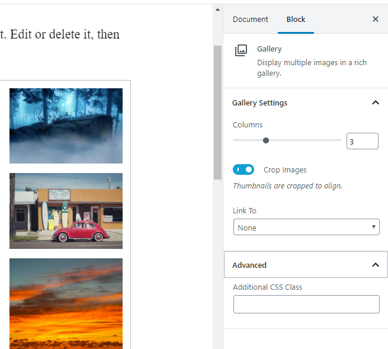
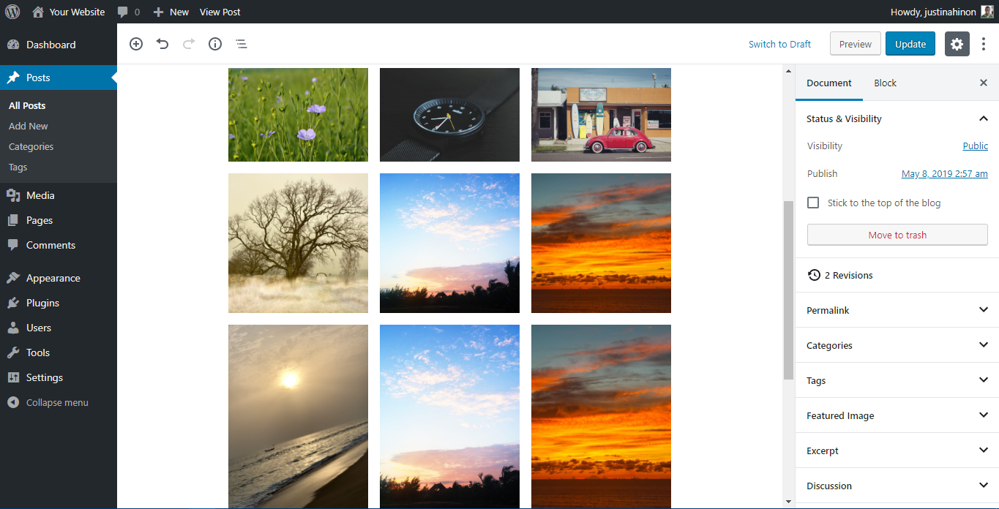
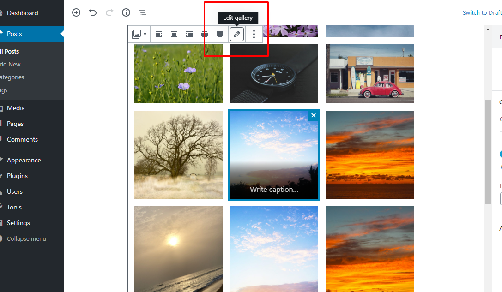

# The WordPress Gallery (Block Editor)

Note: This page uses Block Editor. If you are a Classic Editor User, refer [this page](../../classic-wordpress/classic-editor/the-wordpress-gallery-classic-editor.md).

## Overview

Image galleries are a great way to share groups of pictures on your WordPress site. The **Create Gallery** feature of the WordPress media uploader allows you to add a simple image gallery to pages or posts on your site.

*End result of published gallery*

This article introduces how to add an image gallery using the media library.

## Adding image gallery using media library

Here’s how to add an image gallery step-by-step, using the media uploader:

*Note: Before adding a gallery, you should be comfortable using the* Add media *feature and the media uploader to [add images to your media library and place them into posts](../../classic-wordpress/classic-editor/inserting-images-into-posts-and-pages-classic.md).*

### Step 1 – Place your cursor

A gallery can go anywhere on a page or post – by itself on a blank page, or above, below, or in the midst of text. Start by placing your cursor where you want the gallery to appear – if it’s in between blocks of text, like in the photo example below, consider adding a return and placing your cursor on a new line so there’s space above and below.

*Place cursor where gallery should be*

### Step 2 – Select the Gallery block

Once you’ve placed your cursor where you want your image gallery to appear, click on the **+** symbol on the left of the cursor and select Gallery.

### Step 3 – Add and/or Select the Images You Want to Include

You can add or select the images you want to include in your image gallery by choosing from either of the following options in the center of the media uploader window:

-   **Upload Files:** Upload the images you want to use from your computer by dragging them into the upload area. You can add more than one image, and they will be automatically grouped together as an image gallery.
-   **Media Library:** Select from previously uploaded images in the media library by clicking on the ones you wish to add to the gallery. You will see a checkbox next to your selections.

*Select the images you want to add from the media gallery*

*Note: You can create an image gallery using directly images from your computer simply by switching back and forth between the Upload Files and Media Library options.*

As you upload and/or select images, you will see your selection confirmed on the Insert Media screen by checkboxes at the top corner of each thumbnail. Also, a row of thumbnails appears at the bottom of the window to help you keep track of all the images you’ve selected. When you are happy with your selection, click the **Create a new gallery** button.

### Step 4 – Edit Your Gallery

On the Edit Gallery page, you can do the following things before inserting the gallery you have created into your page or post:

-   **Rearrange your images:** Drag and Drop image thumbnails to rearrange the order of images in your gallery.
-   **Reverse Order:** Reverses the order of the images in your gallery.
-   **Add image descriptions:** Add descriptions to your images (optional) which appear as image captions below each thumbnail in the gallery.
-   **Remove images:** Hover over a thumbnail and click on the “X” to remove any of the images you previously selected.
-   **Add more images:** Click on the “Add to Gallery” link in the left-hand sidebar and add or select the images you want to include in your image gallery by choosing from either “Upload Files” or “Media Library” tabs.
-   **Cancel Gallery:** Click on the “Cancel Gallery” link from the actions on the left to exit the Edit Gallery page and cancel your image gallery.

After inserting your gallery, you also have several Gallery Settings available in the right pane of your editor screen:

-   **Links To:** Controls whether the gallery thumbnails (on the published page/post) link to the image attachment page or directly to the source image file itself.
-   **Columns:** Set the number of columns you would like to have in your gallery. 3 Columns is the default settings, which is ideal for most sites.

### Editing Existing Galleries

Within the visual editor, the image gallery is displayed as a series of thumbnail images.

*Gallery in WordPress editor*

When you click any area of the image gallery, icon buttons appear top of the area. At any time, you can edit the images or settings of your gallery by clicking on the Edit button. You can remove the image gallery at any time by clicking on the Remove button.

*Edit image to edit*

## Resources & Gallery Plugins

-   [Gallery Plugins](https://wordpress.org/plugins/search/gallery)
