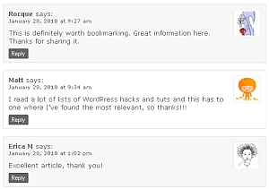

# Use Images

## Working with Images

Adding images in WordPress is very easy. All of your images will be stored and can be managed in the Media Library, but you can take several different paths to get there.

The most common path is adding an image directly to a post or page. This automatically saves the image in the Media Library and displays the image wherever you inserted it.

You can also add images directly to the Media Library through the multi-file loader or the single-file loader.

Further reading:

-   [Media library screen](../administration-screens/media-screens/media-library-screen.md)
-   [Media Add New Screen](../administration-screens/media-screens/media-add-new-screen.md)
-   [Edit Media](edit-media.md)
-   [Settings Media Screen](../administration-screens/settings/settings-media-screen.md)

## Adding Images Through Pages/Posts

When writing or editing a post, you can add an image using the Add Media button above the editor box. This opens a window that displays the multi-file uploader. From here you can drag and drop your picture or select it using the file selector.

The images you add here will be automatically added to the Media Library.

Further reading:

-   [Inserting Images into Posts and Pages (Block Editor)](inserting-images-into-posts-and-pages-block-editor.md)
-   [Inserting Images into Posts and Pages (Classic Editor)](../../classic-wordpress/classic-editor/inserting-images-into-posts-and-pages-classic.md)

## Miscellaneous

WordPress can resize images and create thumbnails.

Further reading:

-   [Image Size and Quality](image-size-and-quality.md)
-   [Use image and file attachments](use-image-and-file-attachments.md)

## Special Contents Using Images

*Gravatar in comments*

-   [How to Use Gravatars in WordPress](../users-roles-and-profiles/use-gravatars.md) – Display avatars in your comment stream.
-   [Smilies](../writing-and-publishing/formatting/what-are-smilies.md) – How to use smilies or emoticons on WordPress.

## Resources

-   [Image Compression on Wikipedia](http://en.wikipedia.org/wiki/Image_compression)
-   [WordPress Inspiration – Showcase](https://wordpress.org/showcase/)
