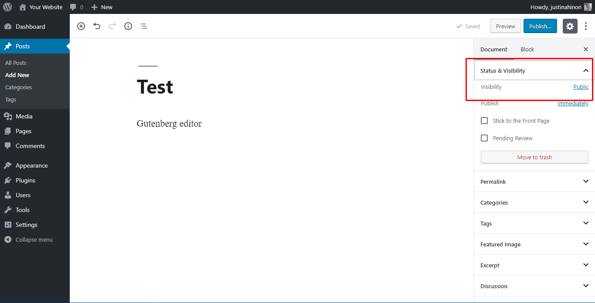
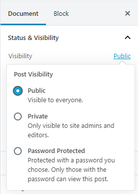
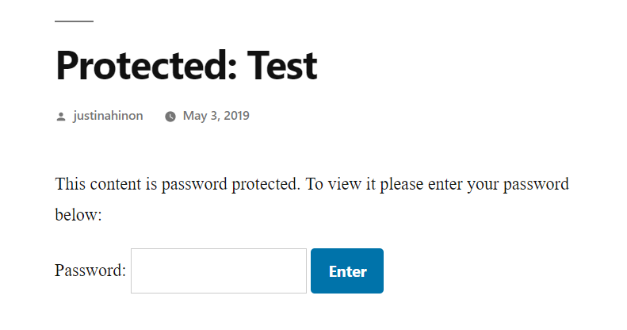
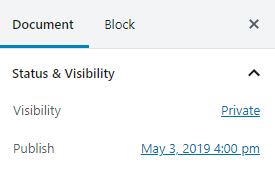

# Set blog content visibility (Block Editor)

Note: This page uses Block Editor. If you are a Classic Editor User, refer [this page](../../classic-wordpress/classic-editor/content-visibility-classic-editor.md).

Content visibility is about controlling who can see your blog content. WordPress allows you to control the visibility of your posts and [Pages](create-pages.md) on an individual basis. By default, all posts and Pages are visible.

There are several ways to set the visibility for your blog content. You can set it on a per post/Page basis for public, private, or Password Protected, or make the entire blog private and Password Protected through the use of WordPress Plugins.

## Setting Page and Post Visibility

The option is available in the **Document** tab on the right of the page under “**Status & Visibility**“. The screenshot below shows the interface, with the relevant section highlighted in the red rectangle.

The default state for post and Page visibility is **Public**. Public visibility means that the content will be visible to the outside world as soon as it is published.

By clicking on the edit link next to **Visibility: Public** in the Publish options, you can choose from an expanded selection of visibility options.

The options are:

-   **Public:** The default, viewable to all.
-   **Private:** This option hides the content from the public completely.
-   **Password Protected:** Clicking this radio button followed by “OK” causes a further text box to appear, into which you can enter a password.

### Password Protected Content

Password Protected content is not immediately visible to the outside world. Instead, visitors will see a prompt similar to this:

The title for your protected entry is shown, along with a password prompt. A visitor to your site must enter the password in the box in order to see the content of the post or Page.

### Private Content

Private content is published only for your eyes, or the eyes of only those with authorization permission levels to see private content. Normal users and visitors will not be aware of private content. It will not appear in the article lists. If a visitor were to guess the URL for your private post, they would still not be able to see your content. You will only see the private content when you are logged into your WordPress blog.

Once you change the visibility to private, the post or page status changes to “Privately Published” as shown. Private posts are automatically published but not visible to anyone but those with the appropriate permission levels (Editor or Administrator).

**WARNING:** If your site has multiple editors or administrators, they will be able to see your protected and private posts in the **Edit** screen. They do not need the password to be able to see your protected posts. They can see the private posts in the **Edit** Posts/Pages list, and are able to modify them, or even make them public. Consider these consequences before making such posts in such a multiple-user environment.

## Hiding The Entire WordPress Blog

Currently the functionality to hide your entire blog from public view, or to restrict it to certain users, is not part of the core WordPress product. There are possible plans to introduce this functionality into a later version.

There are various WordPress Plugins to restrict the visibility such as:

-   [Page Restrict](https://wordpress.org/plugins/pagerestrict/)
-   [Force Login](https://wordpress.org/plugins/wp-force-login/)
-   [jonradio Private Site](https://wordpress.org/plugins/jonradio-private-site/)

Alternatively, you could use the `.htaccess` to restrict who can visit your web site, but this is beyond the scope of this document.
