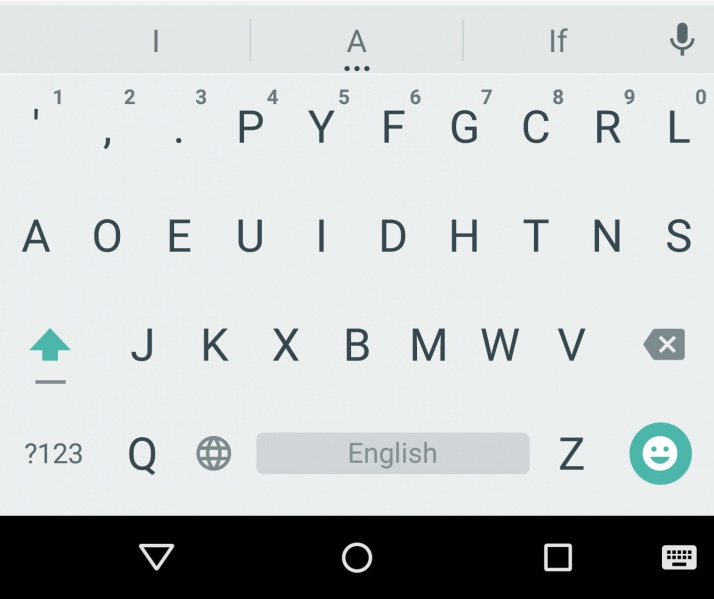
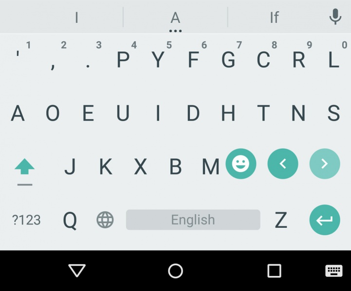

# What are Emoji?

## Introduction to Emoji

Emoji are the ideograms or smileys 😃 used in electronic messages and Web pages. Originating in Japan on mobile devices, they are now commonly available on devices worldwide, ranging from mobile to desktop computers.

Different operating systems have distinct methods of accessing emoji. Note that these methods work in most applications, not just WordPress.

### Emoji are not Smileys

Not quite. Emoji are a newer development than smileys (a.k.a. emoticons). They are created differently, and handled differently by operating systems and web browsers. For more information about smileys, please see the [Using Smileys](what-are-smilies.md) page.

## Using Emoji on Mobile

### iOS (iPhones, iPads, etc. running iOS 5 and higher)

Follow these instructions to turn the Emoji keyboard on (as of iOS 8 it is enabled by default):

1.  Go into the Settings app
2.  Select “General”
3.  Select “Keyboards”
4.  Tap the Keyboard button, then “Add New Keyboard”
5.  Scroll down and select “Emoji”

After you’ve done this, you will now see a small “smiley face” icon to the left of the space bar when typing. (If you have multiple keyboards enabled, you may see a globe icon instead.) Tap on this to switch to the Emoji keyboard.

### Android

There is a smiley face button in the lower right corner of the keyboard. Tap this to access emoji.



In some apps, you may need to tap and hold the Enter button for the smiley face button to appear.



## Using Emoji on Desktops

### Windows 10

1.  In Desktop mode, right-click the Taskbar
2.  Click to check the option that says “Show touch keyboard button”

A new icon will appear in the taskbar (lower right hand corner of the screen near the time) that looks like a keyboard. Click the keyboard icon to open the onscreen keyboard, you can then click the smiley face to open the emojis.

### Windows 8

To access emoji in Windows, you have to perform a one-time setup first.

1.  In Desktop mode, right-click the Taskbar
2.  Select “Toolbars”
3.  Select “Touch Keyboard”

A new icon will appear in the System Tray (lower right corner of your screen) that looks like a keyboard.

After that, when you want to type an emoji, just click on that icon and an onscreen keyboard will appear. Click the smiley face next to the space bar, and the alphanumeric keyboard will change to an emoji keyboard.

### Mac OS X (10.7 or higher)

1.  Click the Edit menu
2.  Select “Special Characters”
3.  A small popup keyboard will appear allowing access to emoji and many other special characters.

You can also access this popup by pressing ⌘-control-space.

### Linux

The Symbola font enables emoji display under Linux applications. Installing this font depends on your distribution.

#### Arch Linux

It’s found in the ttf-symbola package under Arch Linux and its derivatives. Installing it is a one-shot command :

```
sudo pacman -S ttf-symbola
```

#### Debian

You need to install it manually under Debian :

1.  Create a custom fonts dir and go into it : mkdir ~/.fonts && cd ~/.fonts
2.  Download Symbola.ttf from a font site (many links possible) using wget; eventually uncompress it if delivered as a ZIP our gzipped file.
3.  Let the magic begin !

#### Fedora

It’s available in the yum repositories, again one commandline from using it :

```
sudo yum install gdouros-symbola-fonts
```

## Converting to images

For backwards compatibility there are wp-emoji.js and twemoji.js JavaScript files being used. They will convert the often greyscale Emoji characters to colored image files.

If you are a developer working on forms, you might want to disable this behaviour in your input fields and textareas. You can use the class attribute with ‘wp-exclude-emoji’ for this.

## Common Emoji

Beyond the standard emoticon-type “smileys”, (e.g. 😃 or 😢) there are hundreds of emoji, ranging from plants and animals (🐱, 🐴, 🌹) to people (👫, 💁), objects (🎥, 🎃), vehicles (🚕), food (🍔), the Sun and Moon, and more.
