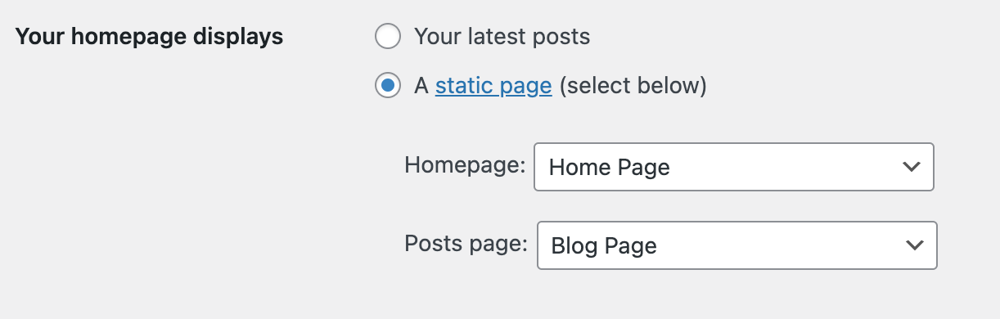
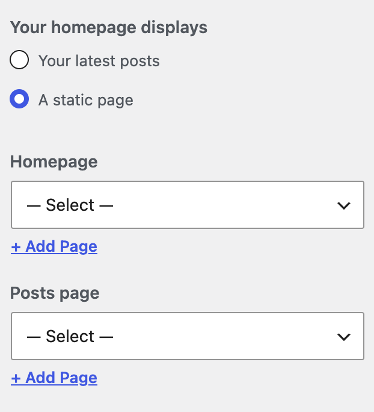

# Create a static front page

The purpose of this document is to explain the process of setting up a static page on your WordPress site. This document doesn’t discuss the automatic display of posts on the Home page. It is a pre-requisite that you understand the difference between the [Pages](../create-pages.md) and Posts.

## What is a Static Front Page

By default, WordPress displays your latest posts on the homepage of your site. This dynamic list updates automatically whenever new posts are published, meaning it is not a static page.

A Static Front Page, on the other hand, is **a specific page** that you manually set as your homepage. Instead of displaying recent posts, this page remains unchanged unless edited, allowing you to create a custom landing page for your site.

## Create a Home Page

1.  Navigate to your WordPress dashboard.
2.  Go to Pages > Add New.
3.  Title this page (e.g., “Home”) and add the desired content.
4.  Publish the page.

<!-- VideoPress embed (iframe removed): https://videopress.com/embed/MFhssVqN -->

https://videopress.com/v/MFhssVqN

## How to set a Static Front Page

*Reminder: to create a page, go to **Pages > Add New***

There are two places you can set your static front page, depending on your theme and preference: through **Reading Settings**, or through the **Customizer**.

#### Option 1: Using Reading Settings

1.  Navigate to Settings > Reading in your dashboard.
2.  Under “Your homepage displays,” select “A static page.”
3.  For “Homepage,” choose the “Home” page you created.
4.  For “Posts page,” select the “Blog” page if required.
5.  Save the changes.

<!-- VideoPress embed (iframe removed): https://videopress.com/embed/CbDPoRL9 -->

https://videopress.com/v/CbDPoRL9

#### Option 2: Using the Customizer

1.  Go to **Appearance > Customize**.
2.  Click on **Homepage Settings**.
3.  Under ‘Your homepage displays’, **select a static page**.
4.  In the **Homepage** dropdown, **select the page you want** to use as your Static Front (Home) Page.
5.  If you want a separate page for your blog posts, use the **Posts page** dropdown to select the empty page you created.
6.  Click **Publish** to save your changes.

Your homepage should now show the Page you selected.

## Changelog

-   Update 2026-06-25
    -   Simplified instructions and added tutorial videos (props @benazeer)
-   Update 2026-04-05
    -   Fix the intro paragraph (props @noumantech, @estelaris)
