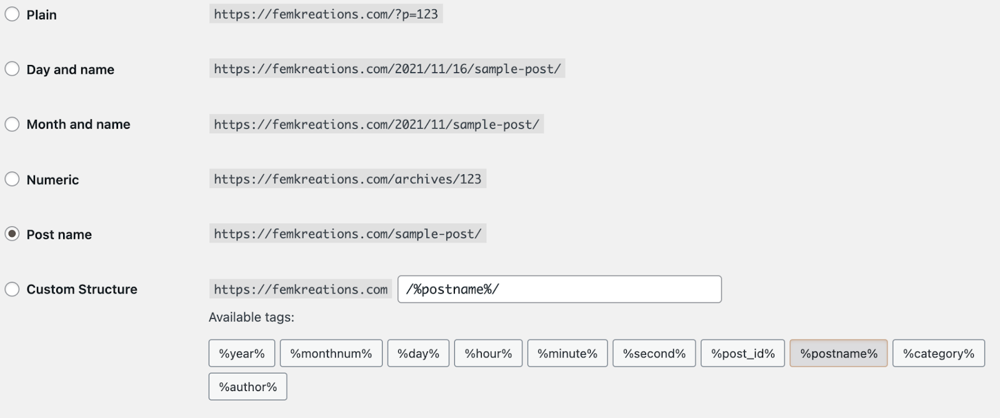
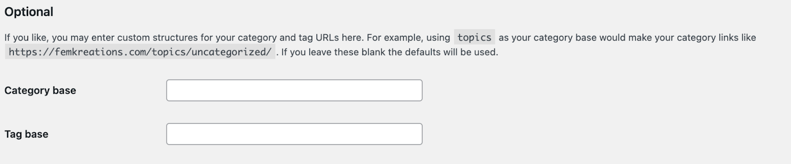

# Customize permalinks

Permalinks are the permanent URLs of your posts, pages, categories, and other archive pages on your website. These URLs are permanent and should never be changed — hence the name *perma*link.

Permalinks help to create a URL structure that is easy for both humans and search engines to understand and share.

-   A permalink is used when another blogger wants to link to your article.
-   You share the permalink when you want to share your content on social media.
-   When Google wants to index your article, they use the permalink of the content.
-   When you want to share a blog post with your friend, you send the permalink of your content in an email.

## Permalink Types

There are three types of WordPress permalinks:

### Plain Permalinks

The default Plain Permalink also called the Ugly Permalink looks like this:

http://example.com/?p=N

with p as the parameter and N is the unique ID of the post or page in the database.

WordPress comes preinstalled with this setting. It works on all server environments. It is not user-friendly and also not optimized for search engines.

### Pretty Permalinks

Pretty Permalinks are SEO-friendly and attractive. They usually contain several words such as the title of the post or page, post category, tag name, etc. You can use Keywords in the URL to make your content readable by search engines.

Pretty Permalinks also help others get an understanding of what the content of the page or post is by reading the URL.

Pretty Permalinks look like this:

http://example.com/2012/post-name/

or

http://example.com/2012/12/30/post-name

### Almost Pretty Permalinks

WordPress provides a third option called the Almost Pretty permalinks. These permalinks have /index.php prefixed before them, like so:

http://example.com/index.php/yyyy/mm/dd/post-name/

Except for this detail, they are similar to Pretty Permalinks.

## Choosing your permalink structure

On the WordPress dashboard, go to Settings → Permalinks Screen. You can choose one of the permalink structures or enter your own in the “Custom structure” field using the *structure tags*.

There are six options to select from:

Plain: This is the Ugly Permalink setting.

Day and name: This uses a year/month/date format followed by your post name.

Month and name: This uses a year/month format followed by your post name.

Numeric: This option uses the ID of the post from the row in the wp_posts table of your database.

Post name: This one uses the name of your post.

Custom Structure: This field allows you to define your own custom URL structure using the structure tags available in WordPress.

The default setting is Plain, which is automatically configured when you install WordPress.

**NOTE:** 
Your hosting provider should have set up the web servers with the necessary configurations for the Pretty and Almost Pretty Permalinks to work correctly. If they are not, then you need to contact your hosting provider.

### Structure Tags

WordPress provides the following structure tags for creating your own custom permalinks. You can use these tags to customize your Pretty or Almost Pretty permalinks.

**Note:**

-   You do not put your website URL in the permalinks fields. You only use one of the structure tags or a combination of tags.
-   To use the Almost Pretty Permalinks, start your permalink structure with index.php/.
-   End your structure with either %post_id% or %postname% so that WordPress can target an individual post for every permalink. (E.g. /%year%/%monthnum%/%day%/%postname%/)

**%year%**

The year of the post in four digits, eg:  2018

**%monthnum%**

Month the post was published, in two digits, eg: 05

**%day%**

Day the post was published in two digits, eg: 28

**%hour%**

Hour of the day, the post was published, eg: 15

**%minute%**

Minute of the hour, the post was published, eg:  43

**%second%**

Second of the minute, the post was published, eg: 33

**%post_id%**

The unique ID of the post, eg: 423

**%postname%**

A sanitized version of the title of the post (*post slug* field on Edit Post/Page panel).

Eg: “This Is A Great Post!” becomes this-is-a-great-post in the URI.

**%category%**

A sanitized version of the category name (*category slug* field on New/Edit Category panel).

Nested sub-categories appear as nested directories in the URI.

**%author%**

A sanitized version of the post author’s name.

### Category base and Tag base

You also have the option of setting custom category and tag bases for your site on the same screen under the **Optional** settings section.

The *Category base* and *Tag base* are prefixes used in URLs for category and tag archives, which look like this:

example.net/category_base/category_name

example.net/tag_base/tag_name

The default values for *Category base* and *Tag base* are category and tag. You can change them, but you can’t remove them from the URLs altogether.

### Using %category% with multiple categories on a post

When you assign multiple categories to a post, only one can show up in the permalink. Which category gets displayed in the permalink is determined alphabetically.

If you want to choose which category shows up in the permalink, you can use one of the plugins from the [plugin directory](https://wordpress.org/plugins/search/taxonomy/).

## Changelog

-   Updated 2025-06-28
    -   Added Alt texts.
