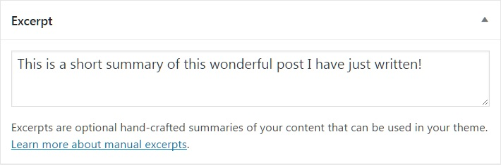

# What is an excerpt? (Classic Editor)

## What is an excerpt

Excerpt is an optional text associated to a Post. Most of the time, it is used as the **Post summary**.

*WordPress excerpt metabox*

Not finding the Excerpt editing box? Check your Post’s **Screen Options**.

Regarding the Theme you are using on your site, Excerpts can be displayed on different pages (search results, archives, etc.).

If Excerpt is empty, WordPress automatically creates an excerpt using the first 55 words of the post.

## How to display excerpts on the posts page

1.  Go to **Settings > Reading**.
2.  Scroll to **For each article in a feed, show**.
3.  Select **Summary**.
