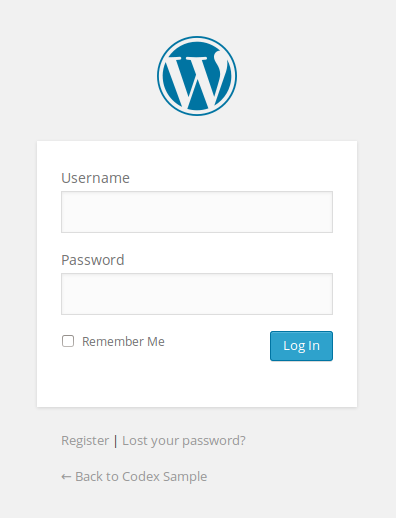
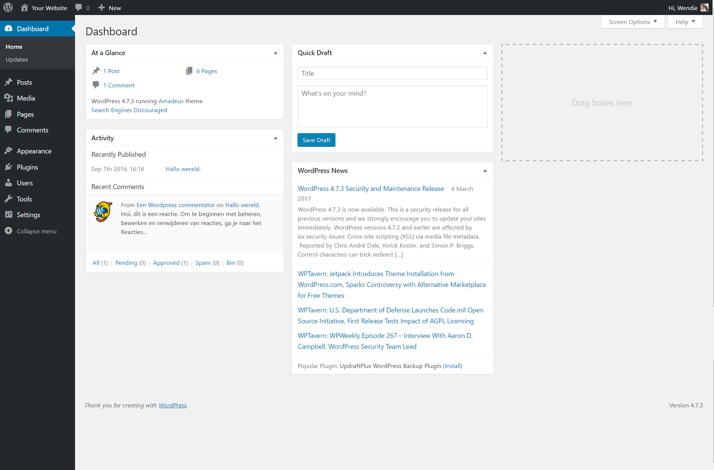
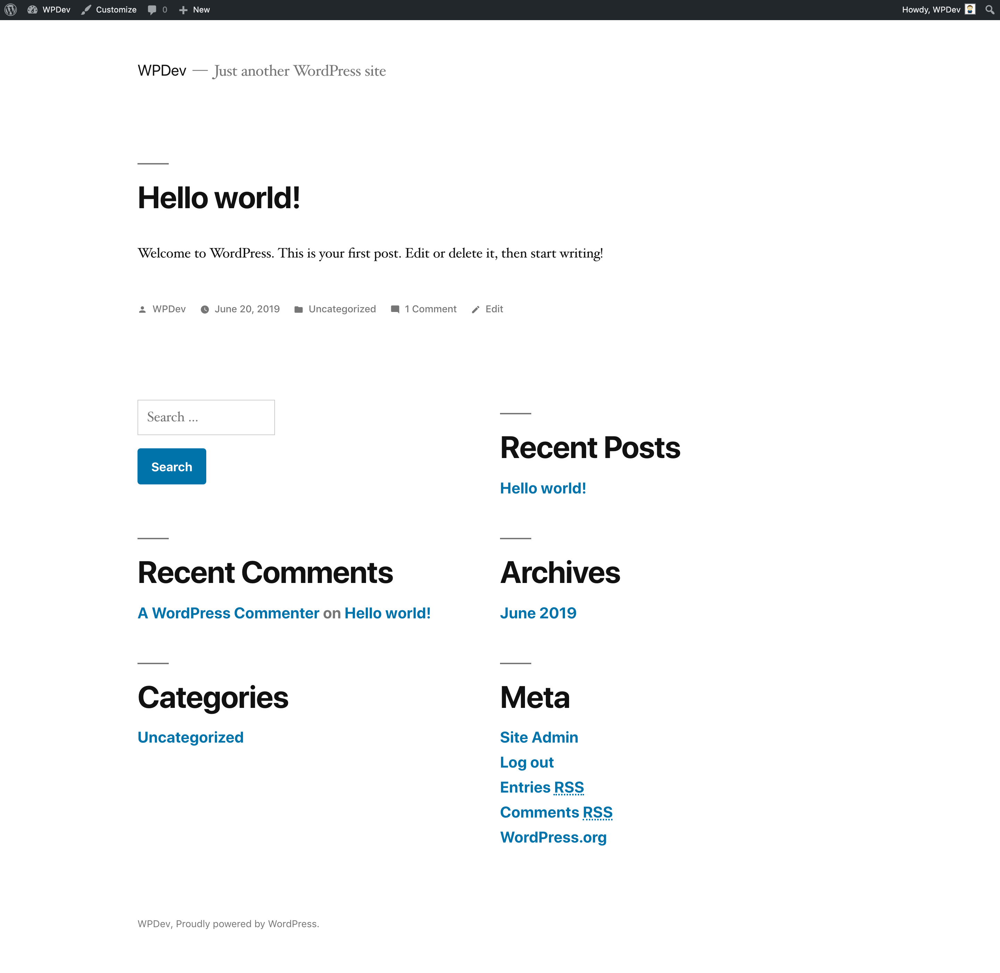
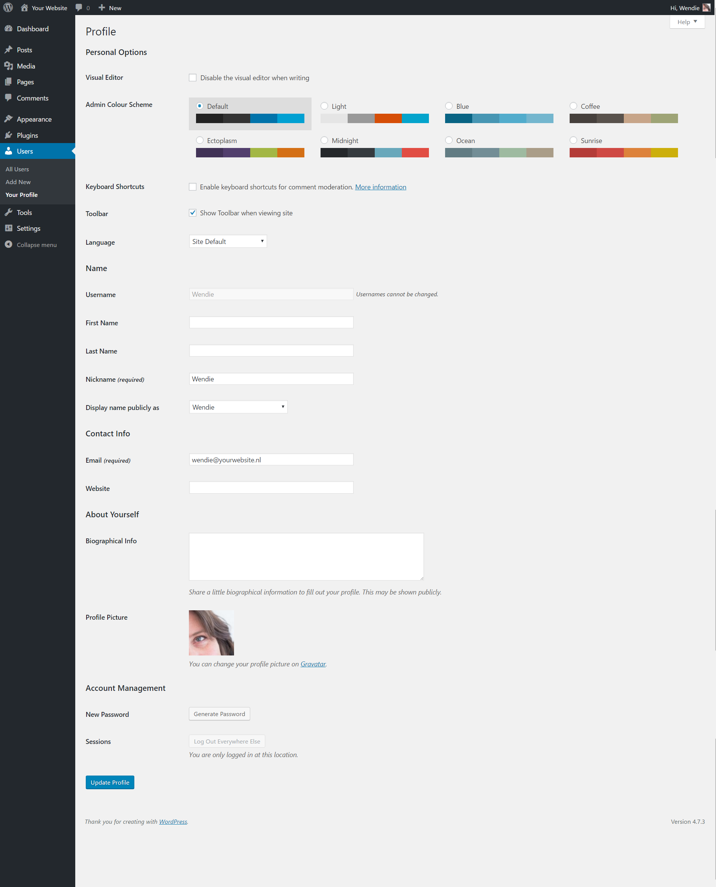
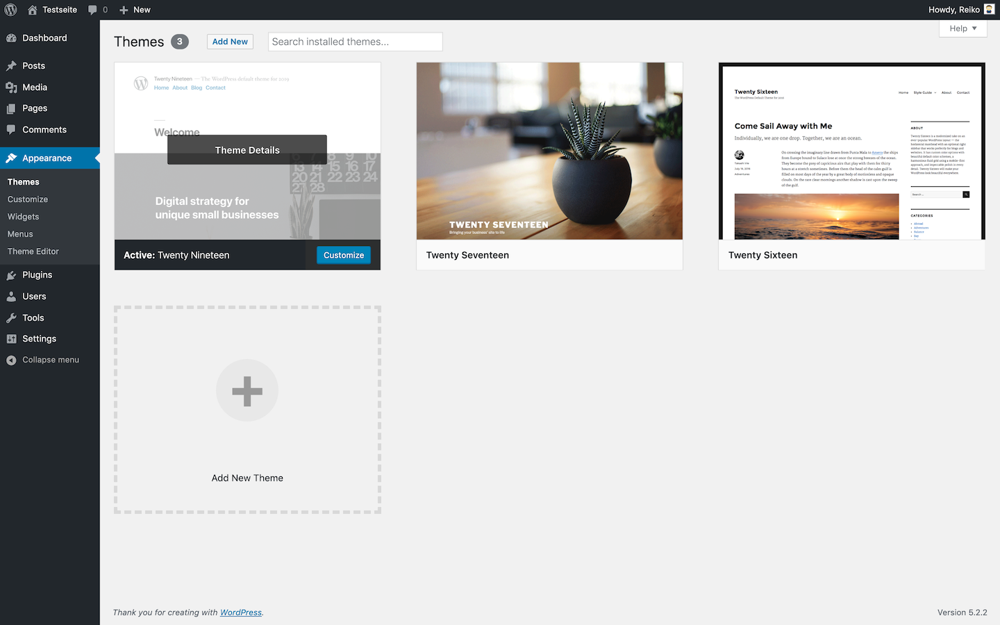
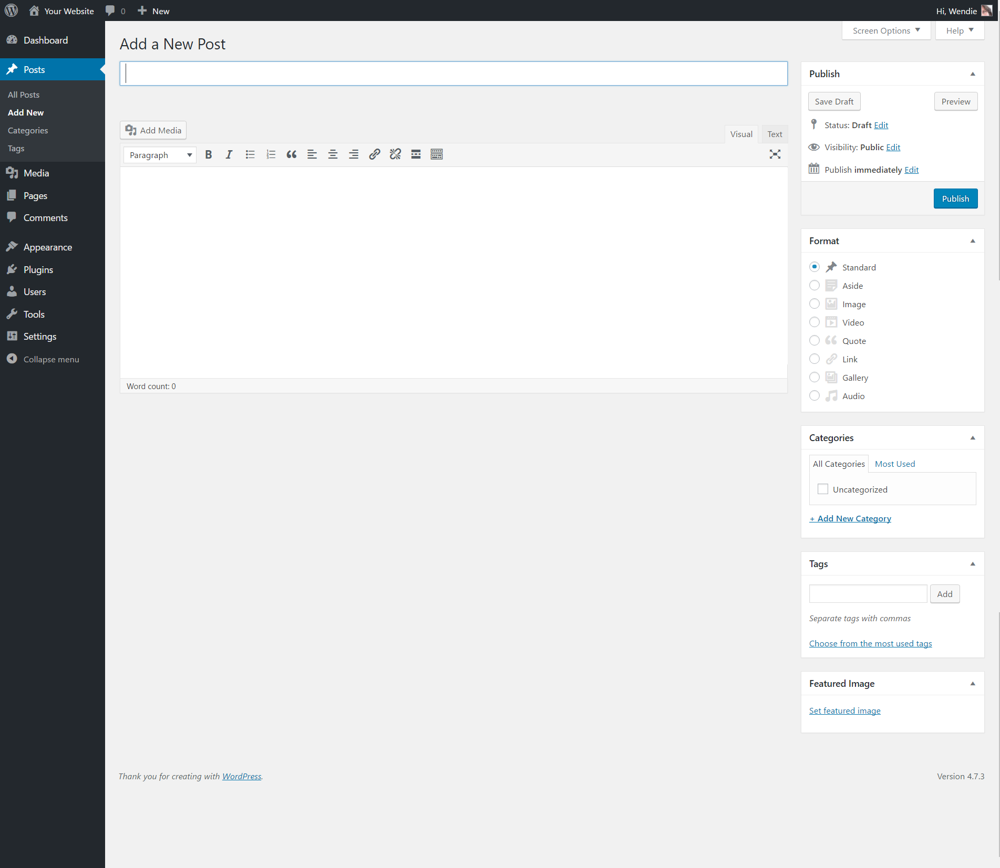
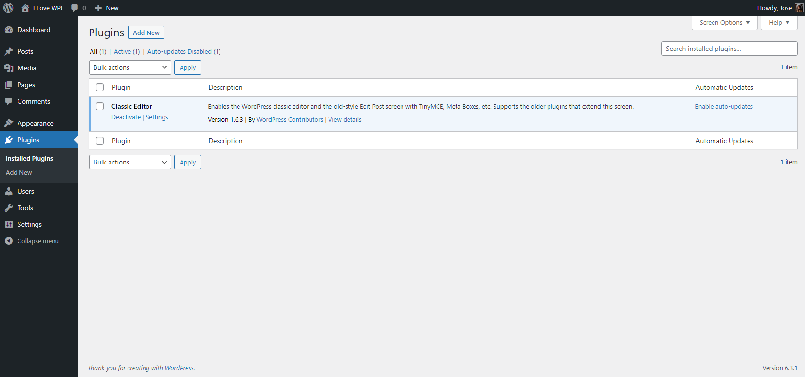

# First steps with WordPress (Classic Editor)

Note: This page refers to WordPress using the older or Classic Editor. If you are on a new version of WordPress or using the block editor, refer to [this page](first-steps-with-wordpress-block-editor.md).

## I have done the 5-minute installation. Now what?

You’ve just completed the [5-Minute Installation](https://developer.wordpress.org/advanced-administration/before-install/howto-install/) of WordPress or the one-click install from your web host. So what is your next step?

Let’s take a step-by-step tour through your WordPress site and see how the different functions work and how to make your new site your own. During the first part of this tutorial, please *don’t change anything within the program* unless it is part of the tutorial. After following these steps, you’ll soon be changing everything.

### Log In

Begin by logging in to the administration area, or the [back end](wordpress-glossary.md#back-end), of your website. Visit your site’s login page by placing *wp-admin* after your domain name (e.g., http://example.com/wp-admin). Some [themes](../../customization/appearance/work-with-themes.md) provide a login link or form on the [front end](wordpress-glossary.md#front-end) as well. Now log in to WordPress using the username and password you created in the 5-minute install.

### Start at the Top

After logging in you are on the main [Administration Screen](../../support-guides/dashboard/administration-screens.md) called the [Dashboard](wordpress-glossary.md#dashboard). This is where the organization of your site begins.

At the top of the screen is the area called the [*toolbar*](../../support-guides/dashboard/administration-screens.md#toolbar-keeping-it-all-together). Click on your site name; it’s a link and it will take you to a view of your new WordPress site. Like it? Don’t like it? Doesn’t matter, just look at it. This is where you are going to be spending a lot of time!

## Test Drive Your WordPress Site

Take time to look at the site before you get into changing it and figuring out [how it all works](https://codex.wordpress.org/Working_with_WordPress); it’s important to see how the WordPress Twenty Nineteen theme is laid out and how it works. Consider this the test drive before you start adding all the special features.

The layout you are looking at is defined by a [WordPress Theme](../../customization/appearance/work-with-themes.md). It is the [appearance](../../support-guides/dashboard/administration-screens.md#appearance-change-the-look-of-your-blog) of your website, styling the look of the site and the framing of the content. The WordPress Twenty Nineteen theme features a “header” at the top with the title and tagline for your site. Below this is your [Menu](../../support-guides/dashboard/appearance-menus-screen.md), if you have one. Along the side you will see some titles and links. This is the Sidebar. The different items inside a Sidebar are called [Widgets](../../support-guides/dashboard/manage-wordpress-widgets.md). The main middle section of the page is the content area.

Scroll down the page and notice the bar at the end of the page. This is called the “footer.” It says “Proudly powered by WordPress.”

Back to the sidebar, you will see different sections with information. Among these you may find a list of Recent Posts, Recent Comments, Archives, [Categories](../../support-guides/dashboard/administration-screens.md#categories), links to the [Administration Screens](../../support-guides/dashboard/administration-screens.md), Log Out, and RSS feeds. This is part of the menu or navigation Screen that people will use to move around your site, visiting posts from different categories or time periods.

### Take a Quick Trip Around

For now you only have one post. It is residing within a page that is laid out as your *home page* or the front page. If you click on the title of the post, it will take you to the specific page for that post. The first page or home page of your site features the most recent posts on your site. Each post title will link to the actual page of the post. Some Theme designers design their *single* post pages to look different from the home page.

In the single post, pay attention to the layout and notice what is different about the design elements. Is the header different? Smaller, larger, or a different color? Is there a sidebar?

All of these changes are created from a few files called [template files](https://developer.wordpress.org/themes/basics/template-files/). You can learn more about how they work in [Theme Developer Handbook](https://developer.wordpress.org/themes/). For now, however, let’s get on with how the rest of WordPress works.

## Test Drive the WordPress Administration Screens

Now that you have an idea of how your site looks and what the different layout sections are called, it’s time to test drive the [WordPress Administration](https://codex.wordpress.org/Administering_Your_Blog). This is like familiarizing yourself with the backend of your new website. In fact, the first page you see after logging in is called the [Dashboard](wordpress-glossary.md#dashboard), a collection of information and data about the activities and actions on your WordPress site.

The [Dashboard](wordpress-glossary.md#dashboard) features a list of the most recent activity you’ve accomplished on your site and it helps to keep you up to date on new and interesting bits of information from the many WordPress resources.

On the left side of the screen is the **main navigation** menu detailing each of the administrative functions you can perform. Move your mouse down the list and the sub-menus will “fly out” for you to move your mouse to and click. Once you choose a “parent” navigation section, it will open up to reveal the options within that section.

The various menu items are as follows:

-   [Dashboard](../../support-guides/dashboard/administration-screens.md#dashboard-information-central)
-   [Posts](../../support-guides/dashboard/administration-screens.md#posts-make-some-content)
-   [Media](../../support-guides/dashboard/administration-screens.md#media-add-pictures-and-movies-to-your-posts)
-   [Pages](../../support-guides/dashboard/administration-screens.md#pages-your-static-content)
-   [Comments](../../support-guides/dashboard/administration-screens.md#comments-reader-feedback)
-   [Appearance](../../support-guides/dashboard/administration-screens.md#appearance-change-the-look-of-your-blog)
-   [Plugins](../../support-guides/dashboard/administration-screens.md#plugins-add-functionality-to-your-blog)
-   [Users](../../support-guides/dashboard/administration-screens.md#users-your-blogging-family)
-   [Tools](../../support-guides/dashboard/administration-screens.md#tools-managing-your-blog)
-   [Settings](../../support-guides/dashboard/administration-screens.md#settings-configuration-settings)

### Let’s start with the User screen

Click on the **Users** tab. The screen will change and you will see the Screen called [All Users](../../support-guides/dashboard/administration-screens.md#all-users) that shows a list of all your users; from here you can add or change existing users and authors accounts. In the navigation menu, click on the [Your Profile](../../support-guides/dashboard/administration-screens.md#your-profile) menu choice. This is where you will enter information about you, the author and [administrator](../../support-guides/dashboard/roles-and-capabilities.md#administrator) of the site. Fill in the information and click **Update Profile** when done.

Now, let’s look at some other powerful features of the WordPress Admin.

### Changing the Look

The [Appearance, Themes Screen](../../support-guides/dashboard/administration-screens.md#appearance-change-the-look-of-your-blog) allows you to change the look of your site using different [Themes](../../customization/appearance/work-with-themes.md). Themes are presentation styles that completely change the look of your site. Designed by developers and users, there are hundreds of themes available for you to choose from. In your Appearance Screen, you will see a list of currently installed themes, including the WordPress Twenty Nineteen theme. To quickly change the theme, simply click on the Activate button under one of the themes listed, then click on your site name in the top [toolbar](../../support-guides/dashboard/administration-screens.md#toolbar-keeping-it-all-together) to see how it looks. Wow, you have another look. It’s that easy. Go back to **Appearance > Theme** and click the Activate button under the WordPress Twenty Nineteen theme to bring the design back to what you had. To see it again, click your site name in the toolbar, and there it is.

### Creating a post

Back in the [Administration Screen](../../support-guides/dashboard/administration-screens.md), take a look at the [Posts Screen](../../support-guides/dashboard/administration-screens.md#all-posts). You can use the tabs under the Posts Menu to [write and manage your posts](../../support-guides/publishing/write-posts-classic-editor.md). Let’s start by making your first test post in the [Add New](../../support-guides/dashboard/administration-screens.md#posts-make-some-content) tab.

Simply fill in the blanks, one by one, in the post beginning with the title and then write a little test message in the post window. This is just for a test, so you can write anything you want. When you are done, click the **Publish** button that is to the right of the post entry window and it is done. There’s more exciting work ahead! Now that you’ve gotten a feel for writing posts, you can view your posts by clicking your site name in the [toolbar](../../support-guides/dashboard/administration-screens.md#toolbar) at top of the screen.

### Comments

Part of the fun of WordPress is the ability to have viewers leave comments on your site. It creates a dynamic interchange between you and the viewer. Do you want comments on your posts? Comments on posts come in a variety of forms, from *pats on the back* (*Good job! Like the post!*) to extensive conversations and commentary about the posts. Or maybe you are seeking comments that add to the information you’ve posted.
Responding to comments and [moderating them](../../support-guides/publishing/comments-in-wordpress.md) can also take up a lot of time. If they are critical to your site, then include them and consider how you want them presented. You can make a few comments yourself on the post you created. Take a look at how they are laid out and consider how you might want them to look to fit into the design and layout of your site.
When you have reached your decision about how you want to handle comments, take time to read through the [article on comments and WordPress discussion options](../../support-guides/dashboard/settings-discussion-screen.md) to help you set those features.

### Preventing Spam

There is more to think about when it comes to having comments on your site. Unfortunately we live in a world where [spam](https://codex.wordpress.org/Combating_Comment_Spam) is a fact of life. It is recommended that you begin battling the comment spammers with the helpful article, [Introduction to Dealing with Comment Spam](https://codex.wordpress.org/Comment_Spam).

### Create Categories

Posts are usually stored in Categories and/or Tags so you can keep related topics together. Right now you only have one category, but that will soon want more. In the **[Posts > Categories](../../support-guides/dashboard/administration-screens.md#categories)** tab, in the **Add New Category** area, fill in the information about your category. Continue to add your *parent* categories, going down the list. Hold off on entering subcategories until all the main categories are entered.

> **NOTE**:*You can add any new category at any time, but make a note of the fact that categories can be sorted in WordPress in two ways: by name (alphabetically) or by ID number. As you enter the categories, they are assigned an ID number. It is difficult to change this, so if you don’t want your categories sorted alphabetically, enter them in the order you want to see them presented on the screen.*

## Setting Up Your Site

Before you get to the graphic look of your site, let’s do a little more administration to your site to set it up.
You may want to install plugins to supercharge your website, and don’t forget to activate the [Akismet WordPress Plugin](https://wordpress.org/plugins/akismet/) that is available with all WordPress sites to help protect it from comment spam.
When you have the parent categories entered, enter your subcategories. In the pull down menu for Parent Category, you can select the *parent* to the subcategory you are adding. When you view your categories in the Manage > Categories Screen, you will see the categories listed like this:

-   Computer Tips
    -   Windows
    -   Linux
    -   Mac
-   Internet News
-   Web Page Design
    -   Web Standards
-   WordPress
    -   Plugins
    -   Themes

### Put Posts in Categories

Let’s put some of your test posts into categories so you can see how this works.
From the **Posts > Category Screen**, click on the tab for **[All Posts](../../support-guides/dashboard/administration-screens.md#all-posts)**. You should see the test posts you entered here. When you hover your mouse over each post title, under the title, you should see the **Edit | Quick Edit | Trash | View** links. Click on **Edit** to edit one of the posts. On the right side of the Edit Post screen you will now see your **Categories**. Choose one of them by clicking in the box next to it. Then in the Publish module above, click the **Update** button. Repeat this for your other test posts, putting each one in a different category.
Now view your page by clicking on your site name in the [toolbar](../../support-guides/dashboard/administration-screens.md#toolbar-keeping-it-all-together) at the top of your [Administration Screen](../../support-guides/dashboard/administration-screens.md). Do you see the categories listed in the sidebar now? Great. If you are missing a category, that usually means that there are no posts in it. This is the default function of WordPress, so not to worry. When you add a post to the “missing” category, it will appear on your web pages. Click on one of the categories and you will be taken to a page for just that category. You should see the posts that went into that category. This is a generated *Category* page.
Now, click on the **Archives** for the month showing. Now you are visiting a generated page of your posts listed in chronological order for this month – well, specifically for today only. Two methods of finding the same information.

### What Is Next

You’ve now done all the basics for your new WordPress website. You know how to write a post, create a category, and how to view your site’s information by category and archive. You can start the customization process, and when you are done, don’t forget to delete your test posts! Then start writing some wonderful information to share with your new-found public!

## Using WordPress Themes

There are hundreds of [WordPress Themes](../../customization/appearance/work-with-themes.md) to choose from. All do basically the same thing but graphically present the information in a myriad of ways. Choose a few that look interesting to you, and meet your audience’s needs and your desires, and then test drive them following the test drive instructions above. Click through the whole site, the categories and archives as well as the individual posts to see how the Theme handles each one. The look may be nice on the front page, but if it handles things in a way you don’t like on the single post, then you will have to dig into the code and make changes. Not ready for that, try another theme.

-   [WordPress Theme Directory](https://wordpress.org/themes/)
-   [Using Theme](../../customization/appearance/work-with-themes.md)

### Creating your own Theme

If you are familiar with CSS, HTML, and even PHP and MySQL, consider either customizing the Theme to your own needs, or creating your own Theme.

-   [WordPress Theme Developer Handbook](https://developer.wordpress.org/themes/)

## Using WordPress Plugins

[WordPress Plugins](../../customization/appearance/introduction-to-plugins.md) are also known as add-ons or extensions. They are software scripts that add functions and events to your website. They cover the gamut from up-to-date weather reports to simple organization of your posts and categories. Plugins are designed by volunteer contributors and enthusiasts who like challenges and problem solving. They are usually fairly [simple to install](../../customization/appearance/manage-plugins.md) through the WordPress Admin Plugin Screen, just follow the instructions provided by the plugin author. Remember, these are free and non-essential. If you have any problems with plugins, contact the plugin author’s website or plugin source first, then search the Internet for help with that specific plugin, and if you haven’t found a solution, then visit the WordPress forums for more help.

-   [WordPress Plugin Directory](https://wordpress.org/plugins/)
-   [Managing Plugins](../../customization/appearance/manage-plugins.md)

### Creating your own Plugin

If you are familiar with PHP, HTML, and maybe even MySQL, you may be able to customize WordPress to work the way you want by creating your own Plugin.

-   [WordPress Plugin Developer Handbook](https://developer.wordpress.org/plugins/)

## Above and Beyond the Basics

The exciting thing about WordPress is that there are few limits. Thousands of people are using WordPress for blogging and for running their websites. For example, look at some of the entries under the [WordPress.org Theme Showcase](https://wordpress.org/showcase/). All have a different look and different functions on their sites.
What you do from here is up to you, but here are a few places to take that first step beyond the basics:

-   [WordPress Features](https://wordpress.org/about/features/)
-   [Working with WordPress](https://codex.wordpress.org/Working_with_WordPress)
-   [WordPress Semantics](https://codex.wordpress.org/WordPress_Semantics)
-   [Using Pages](../../support-guides/publishing/create-pages.md)
-   [Troubleshooting](https://codex.wordpress.org/Troubleshooting)
-   [Using Permalinks](../../support-guides/publishing/customize-permalinks.md)
-   [Getting More Help](https://codex.wordpress.org/Getting_More_Help)
-   [Using the Support Forums](https://codex.wordpress.org/Using_the_Support_Forums)
